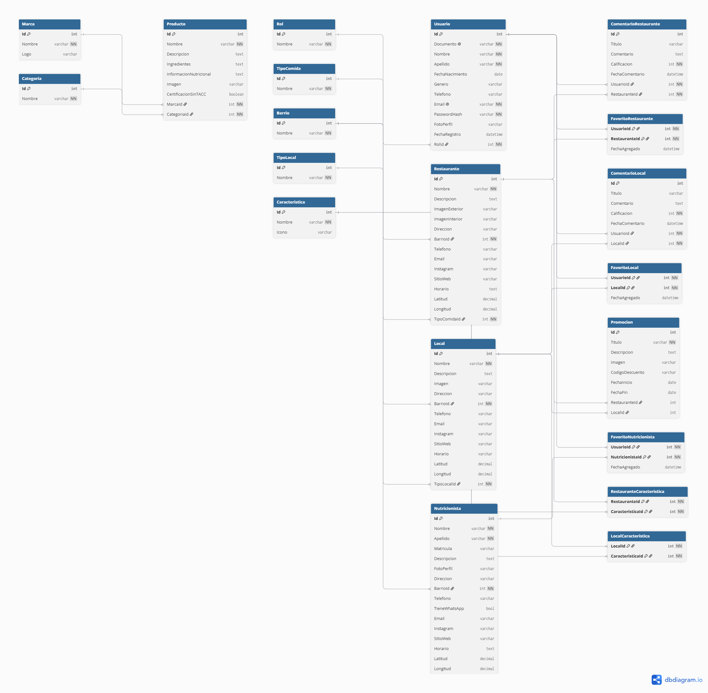
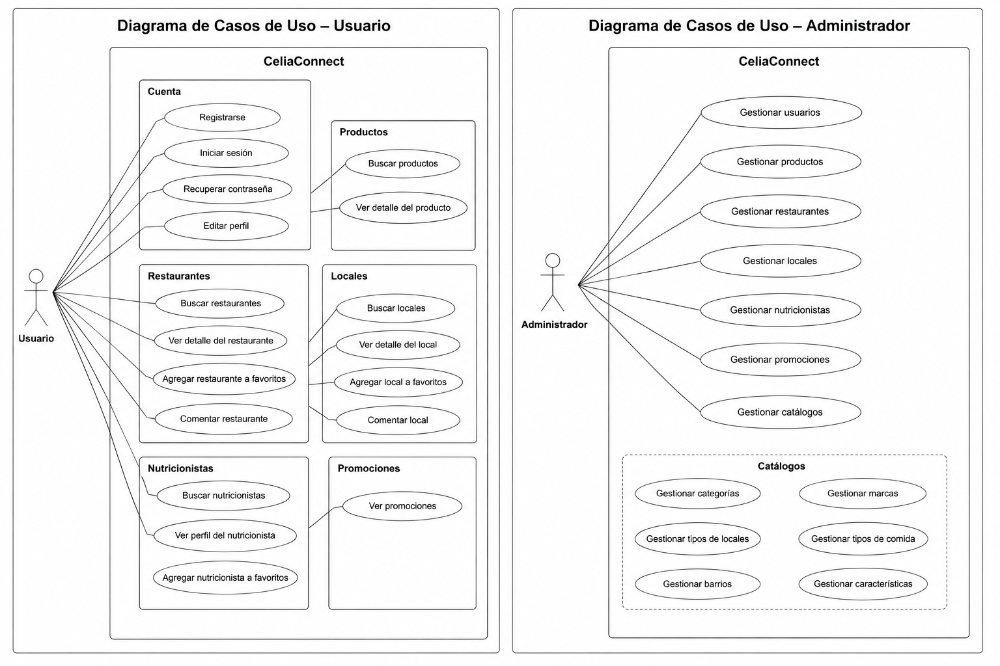
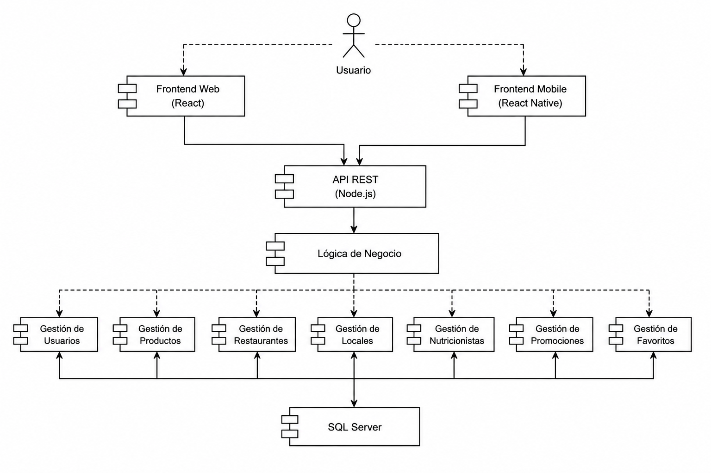
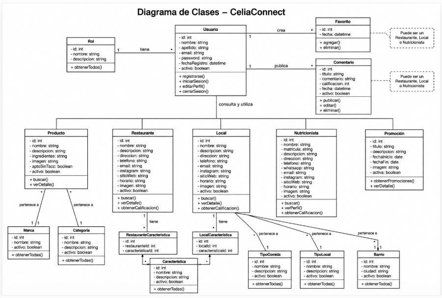

# 06 - Diagramas

## Información del documento

| Campo | Valor |
|--------|--------|
| Proyecto | CeliaConnect |
| Documento | Diagramas |
| Versión | 1.0 |
| Fecha | 25/08/2026 |
| Autor | Carelis Fagundez |
| Estado | En elaboración |

---

# 1. Introducción

El presente documento reúne los principales diagramas desarrollados durante las etapas de análisis y diseño de CeliaConnect.

Cada uno de ellos representa una perspectiva diferente del sistema y permite comprender su estructura, comportamiento, arquitectura y planificación antes de iniciar la etapa de implementación.

Estos diagramas constituyen una herramienta de apoyo para el desarrollo del proyecto, facilitando la comunicación entre los integrantes del equipo y sirviendo como guía durante las fases de construcción, pruebas y mantenimiento.

A medida que avance el proyecto, este documento podrá ampliarse incorporando nuevos diagramas que representen funcionalidades o procesos específicos.

---

# 2. Diagrama Entidad-Relación (DER)

El Diagrama Entidad-Relación (DER) representa el modelo lógico de la base de datos de CeliaConnect.

En él se identifican las principales entidades del sistema, sus atributos y las relaciones existentes entre ellas. Este modelo constituye la base para la implementación física de la base de datos en Microsoft SQL Server y garantiza la integridad de la información almacenada.

---

# 3. Diagramas de Casos de Uso

## 3.1 Usuario

Este diagrama representa las funcionalidades disponibles para los usuarios de CeliaConnect.

Se describen las acciones que un usuario puede realizar dentro de la plataforma, como registrarse, iniciar sesión, consultar productos, restaurantes, nutricionistas, promociones y administrar sus favoritos.

---

## 3.2 Administrador

El mismo diagrama incorpora las funcionalidades exclusivas del administrador del sistema.

Entre ellas se encuentran la gestión de usuarios, productos, restaurantes, locales, nutricionistas, promociones y catálogos necesarios para el correcto funcionamiento de la plataforma.

> **Nota:** En esta etapa del proyecto se decidió representar ambos actores (Usuario y Administrador) dentro de un mismo diagrama para facilitar la comprensión general del sistema.

---

# 4. Diagrama de Componentes

El Diagrama de Componentes representa la arquitectura lógica de CeliaConnect y la interacción entre los principales módulos que conforman la solución.

La arquitectura propuesta está compuesta por:

- Cliente Web
- Aplicación Mobile
- API REST
- Capa de Lógica de Negocio
- Base de Datos Microsoft SQL Server

Este enfoque favorece una arquitectura desacoplada, escalable y de fácil mantenimiento, permitiendo que cada componente evolucione de manera independiente.

---

# 5. Diagrama de Clases

El Diagrama de Clases representa el diseño orientado a objetos de CeliaConnect.

Describe las principales clases del sistema, sus atributos, operaciones y las relaciones existentes entre ellas, proporcionando una guía para el desarrollo del backend y la implementación de la lógica de negocio.

Las clases representadas corresponden a las entidades funcionales más importantes del sistema, manteniendo coherencia con el modelo de datos definido previamente.

---

# 6. Diagrama de Gantt

El Diagrama de Gantt presenta la planificación general del proyecto, organizando las distintas etapas de desarrollo desde el análisis inicial hasta la entrega final.

Permite visualizar las actividades previstas, su duración estimada y la secuencia lógica de ejecución, facilitando el seguimiento del avance del proyecto.

---

# 7. Próximos Diagramas

Durante las siguientes etapas del proyecto podrán incorporarse nuevos diagramas UML que complementen la documentación técnica, entre ellos:

- Diagramas de Secuencia.
- Diagramas de Actividad.
- Diagramas de Despliegue.

La incorporación de estos diagramas dependerá de las necesidades identificadas durante la implementación del sistema.

---

# 8. Consideraciones Finales

Los diagramas presentados constituyen una representación gráfica de la arquitectura, el diseño y la planificación de CeliaConnect.

Su principal objetivo es facilitar la comprensión del sistema, servir como apoyo durante el desarrollo y mantener una documentación técnica organizada que acompañe la evolución del proyecto hasta su finalización.
