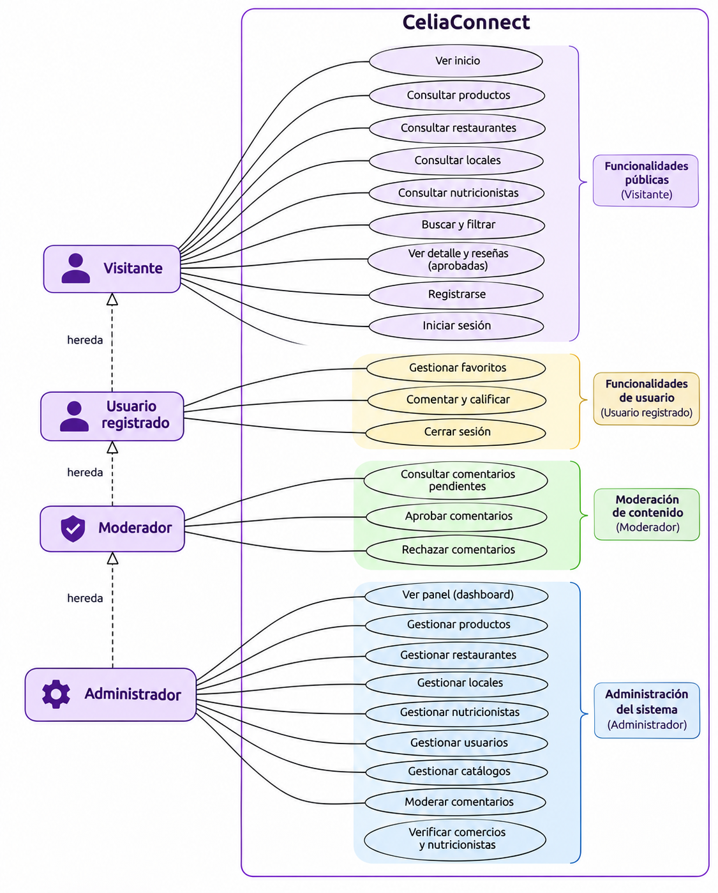
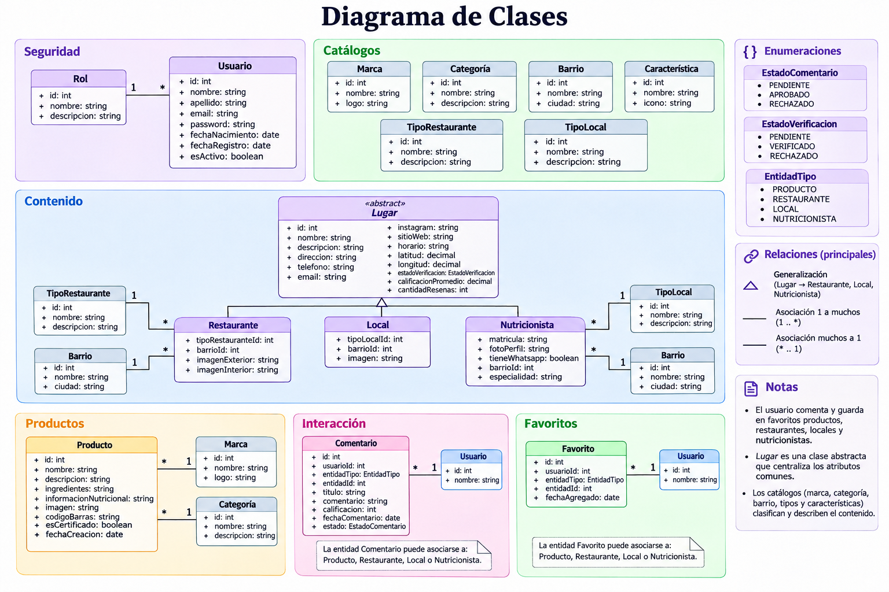
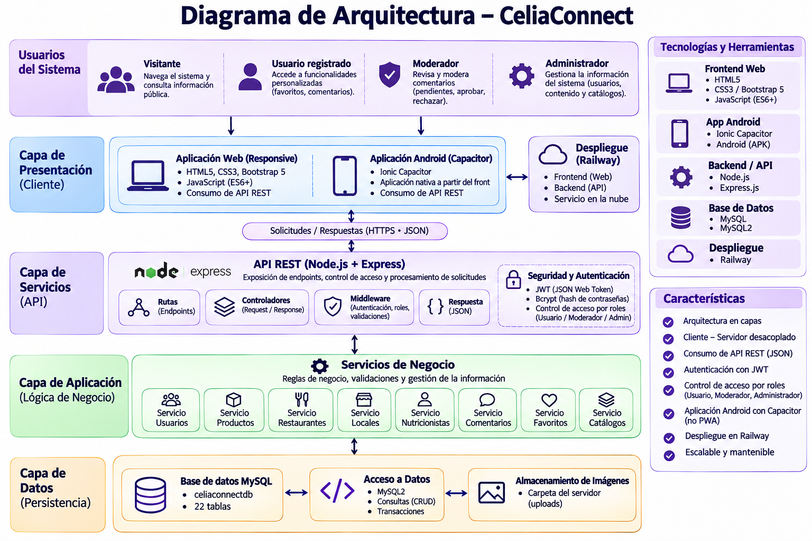
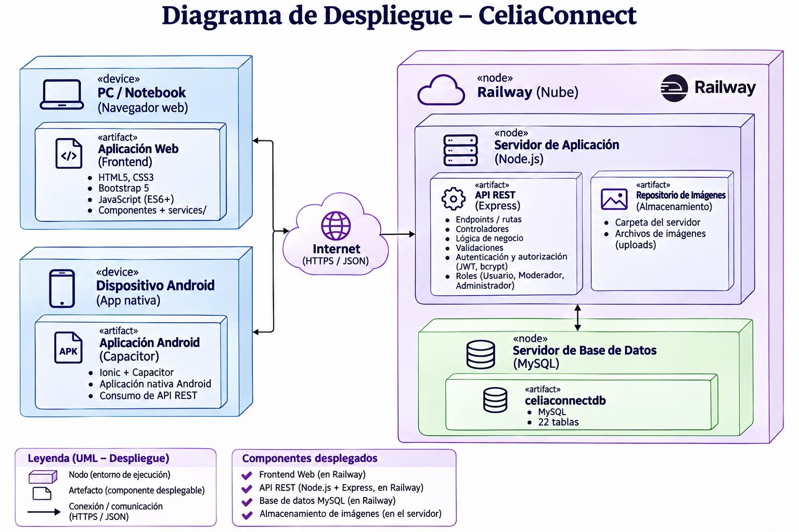

# 06 - Diagramas

## Información del documento

| Campo | Valor |
|---|---|
| Proyecto | CeliaConnect |
| Documento | Diagramas |
| Versión | 4.0 |
| Fecha | 12/11/2026 |
| Autor | Carelis Fagundez |
| Estado | Actualizado — MVP funcional |

---

# 1. Introducción

El presente documento reúne los principales diagramas utilizados para representar el análisis, diseño, arquitectura, implementación y despliegue de **CeliaConnect**.

Los diagramas permiten observar el sistema desde diferentes perspectivas: comportamiento de los usuarios, estructura lógica, componentes tecnológicos, arquitectura general, modelo de datos, infraestructura de producción y planificación del proyecto.

La documentación corresponde al estado actual del MVP de CeliaConnect, compuesto por:

- Aplicación Web responsive.
- Aplicación Android mediante Capacitor.
- API REST desarrollada con Node.js y Express.
- Autenticación mediante JWT y bcrypt.
- Acceso a datos mediante MySQL2.
- Base de datos MySQL.
- Despliegue mediante Railway.
- Sistema de roles: Usuario, Moderador y Administrador.
- Gestión de favoritos.
- Comentarios y calificaciones.
- Moderación de contenido.
- Panel administrativo.
- Dashboard.

Los diagramas incluidos son:

1. Diagrama de Casos de Uso.
2. Diagrama de Clases.
3. Diagrama de Componentes.
4. Diagrama de Arquitectura.
5. Diagrama de Despliegue.
6. Diagrama Entidad-Relación detallado.
7. Diagrama Entidad-Relación general.
8. Diagrama de Gantt.

---

# 2. Diagrama de Casos de Uso

El **Diagrama de Casos de Uso** representa las principales interacciones entre los distintos actores y las funcionalidades disponibles en CeliaConnect.

El sistema contempla cuatro actores principales:

| Actor | Descripción |
|---|---|
| Visitante | Persona que utiliza CeliaConnect sin iniciar sesión. |
| Usuario registrado | Usuario autenticado que puede utilizar funcionalidades personalizadas. |
| Moderador | Usuario responsable de revisar y moderar contenido generado por los usuarios. |
| Administrador | Usuario con permisos de gestión y administración del sistema. |

### Visitante

Puede acceder a las funcionalidades públicas del sistema:

- Ver la página de inicio.
- Consultar productos.
- Consultar restaurantes.
- Consultar locales.
- Consultar nutricionistas.
- Buscar y filtrar información.
- Consultar detalles.
- Consultar comentarios y calificaciones aprobadas.
- Registrarse.
- Iniciar sesión.

### Usuario registrado

Además de las funcionalidades disponibles para un visitante, puede:

- Gestionar favoritos.
- Publicar comentarios.
- Asignar calificaciones.
- Mantener una sesión autenticada.
- Cerrar sesión.

### Moderador

Puede:

- Acceder a las funcionalidades autorizadas para su rol.
- Consultar comentarios pendientes.
- Aprobar comentarios.
- Rechazar comentarios.

### Administrador

Puede:

- Acceder al panel administrativo.
- Consultar el dashboard.
- Gestionar usuarios.
- Gestionar productos.
- Gestionar restaurantes.
- Gestionar locales.
- Gestionar nutricionistas.
- Gestionar información administrativa.
- Moderar comentarios.
- Consultar indicadores generales del sistema.

El siguiente diagrama representa estas relaciones entre actores y funcionalidades:



El detalle textual de cada caso de uso se encuentra documentado en `07-casos-de-uso.md`.

---

# 3. Diagrama de Clases

El **Diagrama de Clases** representa conceptualmente las principales entidades que forman parte de CeliaConnect y las relaciones existentes entre ellas.

Entre las clases principales se encuentran:

- Rol.
- Usuario.
- Producto.
- Marca.
- Categoría.
- Restaurante.
- Local.
- Nutricionista.
- Barrio.
- TipoRestaurante.
- TipoLocal.
- Característica.
- Comentario.
- Favorito.

El modelo permite representar la relación entre los usuarios y los diferentes elementos disponibles dentro de la plataforma.

Los productos se relacionan con sus correspondientes marcas y categorías, mientras que restaurantes, locales y nutricionistas incorporan información de ubicación y clasificación.

Los usuarios pueden interactuar con los elementos del sistema mediante dos mecanismos principales:

- **Favoritos**, para guardar elementos de interés.
- **Comentarios y calificaciones**, para registrar opiniones sobre productos, restaurantes, locales y nutricionistas.

A nivel conceptual, `Comentario` y `Favorito` pueden representarse como entidades generales.

En la implementación física de la base de datos, estas relaciones se encuentran separadas según el tipo de entidad para mantener una estructura relacional clara y garantizar la integridad referencial.



---

# 4. Diagrama de Componentes

El **Diagrama de Componentes** representa los principales componentes tecnológicos que forman CeliaConnect y la forma en que se comunican.

La solución se encuentra compuesta por los siguientes elementos principales:

### Aplicación Web

La aplicación Web constituye uno de los clientes del sistema y fue desarrollada utilizando:

- HTML5.
- CSS3.
- Bootstrap 5.
- JavaScript vanilla.

La interfaz permite consultar información y consumir los servicios proporcionados por la API REST.

### Aplicación Android

La aplicación móvil reutiliza el frontend responsive de CeliaConnect y se integra con Android mediante:

- Capacitor.
- Android.
- Android Studio.
- Gradle.

La aplicación Android consume la misma API REST que la aplicación Web.

### API REST

El backend centraliza la lógica de negocio y expone los servicios utilizados por ambos clientes.

Fue desarrollado mediante:

- Node.js.
- Express.
- JSON.
- HTTPS.

La API gestiona, entre otras funcionalidades:

- Usuarios.
- Autenticación.
- Productos.
- Restaurantes.
- Locales.
- Nutricionistas.
- Favoritos.
- Comentarios.
- Calificaciones.
- Moderación.
- Administración.

### Seguridad

La autenticación y autorización se implementan mediante:

- JWT para la gestión de sesiones.
- bcrypt para el almacenamiento seguro de contraseñas.
- Control de acceso basado en roles.

### Acceso a datos

El backend utiliza `mysql2/promise` para realizar consultas directamente sobre la base de datos.

CeliaConnect **no utiliza Sequelize ni otro ORM**.

### Base de datos

La persistencia de información utiliza MySQL:

- MySQL/MariaDB en el entorno local.
- MySQL desplegado en Railway para producción.

El siguiente diagrama representa la organización y comunicación entre estos componentes:


---

# 5. Diagrama de Arquitectura

El **Diagrama de Arquitectura** representa la estructura general de CeliaConnect y la comunicación entre sus distintas capas.

La solución utiliza una arquitectura **cliente-servidor**, donde existen dos clientes principales:

- Aplicación Web responsive.
- Aplicación Android mediante Capacitor.

Ambos clientes se comunican mediante **HTTPS/JSON** con una API REST centralizada.

La arquitectura puede dividirse conceptualmente en las siguientes capas:

### Capa de presentación

Contiene las interfaces utilizadas por los usuarios:

- Aplicación Web.
- Aplicación Android.

Ambas reutilizan el frontend desarrollado con HTML, CSS, Bootstrap y JavaScript.

### Capa de servicios

Está constituida por la API REST desarrollada con Node.js y Express.

Esta capa recibe las solicitudes de los clientes, aplica controles de autenticación y autorización y deriva las operaciones correspondientes.

### Lógica de negocio

Gestiona las reglas y operaciones relacionadas con:

- Usuarios.
- Productos.
- Restaurantes.
- Locales.
- Nutricionistas.
- Favoritos.
- Comentarios.
- Calificaciones.
- Moderación.
- Administración.

### Acceso a datos

La comunicación con MySQL se realiza directamente desde el backend utilizando `mysql2/promise`.

### Capa de datos

La base MySQL centraliza la persistencia de información utilizada tanto por la aplicación Web como por Android.

Esta arquitectura permite mantener una única fuente de información y compartir la misma lógica de negocio entre ambos clientes.



---

# 6. Diagrama de Despliegue

El **Diagrama de Despliegue** representa la infraestructura donde se ejecutan los distintos componentes de CeliaConnect.

En producción intervienen tres elementos principales:

### Cliente Web

Los usuarios pueden acceder a CeliaConnect mediante un navegador Web.

El frontend se encuentra desplegado en Railway y está disponible públicamente en:

`https://celiaconnect.up.railway.app`

### Aplicación Android

La aplicación Android se genera mediante Capacitor y Android Studio.

La aplicación instalada en el dispositivo se comunica directamente con la API REST desplegada utilizando HTTPS.

### Backend / API REST

El backend Node.js + Express se encuentra desplegado como un servicio independiente en Railway.

Dirección pública:

`https://celiaconnect-production.up.railway.app`

### Base de datos

La base MySQL de producción se encuentra dentro de la infraestructura del proyecto en Railway.

El acceso a la base de datos se realiza exclusivamente desde el backend.

Los clientes Web y Android **no acceden directamente a MySQL**.

El flujo principal de producción es:

```text
Navegador Web ───────┐
                     │
                     ▼
                  API REST
                     │
                     ▼
                   MySQL
                     ▲
                     │
Aplicación Android ──┘
```

El siguiente diagrama representa gráficamente la distribución de estos componentes en el entorno de producción:



---

# 7. Diagrama Entidad-Relación Detallado

El **Diagrama Entidad-Relación detallado** representa la estructura física de la base de datos de CeliaConnect.

La base de datos contiene las entidades necesarias para gestionar:

### Seguridad y usuarios

- `rol`
- `usuario`

### Catálogos

- `barrio`
- `categoria`
- `marca`
- `tipoRestaurante`
- `tipoLocal`
- `caracteristica`

### Contenido principal

- `producto`
- `restaurante`
- `local`
- `nutricionista`

### Relaciones de características

- `restauranteCaracteristica`
- `localCaracteristica`

### Comentarios y calificaciones

- `comentarioProducto`
- `comentarioRestaurante`
- `comentarioLocal`
- `comentarioNutricionista`

### Favoritos

- `favoritoProducto`
- `favoritoRestaurante`
- `favoritoLocal`
- `favoritoNutricionista`

El modelo establece claves primarias y foráneas que garantizan la integridad de las relaciones entre las entidades.

Los comentarios incorporan:

- Usuario.
- Entidad comentada.
- Título.
- Comentario.
- Calificación.
- Fecha.
- Estado de moderación.

Los estados de moderación permiten diferenciar comentarios:

- Pendientes.
- Aprobados.
- Rechazados.

Los favoritos relacionan un usuario con un producto, restaurante, local o nutricionista.

El siguiente DER muestra las tablas con mayor nivel de detalle, incluyendo sus principales atributos y relaciones:


La fuente de verdad para la estructura física de la base de datos es `database/schemas.sql`.

---

# 8. Diagrama Entidad-Relación General

Además del DER detallado, CeliaConnect cuenta con un **Diagrama Entidad-Relación general**, diseñado para facilitar la comprensión global del modelo.

A diferencia del DER detallado, esta representación prioriza las relaciones entre las entidades y reduce la cantidad de información mostrada dentro de cada tabla.

Permite identificar rápidamente los principales grupos del modelo:

- Usuarios y roles.
- Productos, marcas y categorías.
- Restaurantes y sus clasificaciones.
- Locales y sus clasificaciones.
- Nutricionistas.
- Barrios.
- Características.
- Comentarios.
- Favoritos.

También permite observar claramente que el usuario constituye una entidad central para las funcionalidades personalizadas, ya que se relaciona con los comentarios y favoritos de los diferentes tipos de contenido.

El siguiente diagrama presenta esta vista simplificada:


El DER general debe interpretarse como una representación visual simplificada. Para consultar atributos, claves y relaciones con mayor detalle debe utilizarse el DER detallado y `database/schemas.sql`.

---

# 9. Diagrama de Gantt

El **Diagrama de Gantt** representa la planificación temporal del Proyecto Final CeliaConnect.

La planificación contempla las distintas etapas atravesadas durante el desarrollo:

- Investigación y relevamiento.
- Análisis del problema y benchmarking.
- Definición de requisitos.
- Modelo funcional.
- Modelo de datos.
- Arquitectura del sistema.
- Elaboración de diagramas.
- Diseño de API REST.
- Mockups y diseño UI/UX.
- Desarrollo del frontend.
- Desarrollo de la base de datos.
- Desarrollo del backend.
- Integración frontend/backend.
- Desarrollo de la aplicación Android.
- Testing funcional y técnico.
- Despliegue.
- Correcciones y ajustes.
- Documentación final.
- Preparación de la presentación y defensa.

La documentación se desarrolló en paralelo con las distintas etapas del proyecto y fue actualizándose conforme evolucionó la implementación.

La versión móvil finalmente se implementó mediante **Capacitor y Android Studio**, reutilizando el frontend responsive existente y consumiendo la misma API REST desplegada.

El hito final del proyecto corresponde a la entrega y defensa prevista para el:

**18 de diciembre de 2026.**


---

# 10. Relación entre los diagramas

Los diferentes diagramas representan perspectivas complementarias de CeliaConnect.

| Diagrama | Perspectiva representada |
|---|---|
| Casos de Uso | Interacciones entre los actores y el sistema. |
| Clases | Estructura conceptual de las principales entidades. |
| Componentes | Componentes tecnológicos y sus responsabilidades. |
| Arquitectura | Organización general de las capas y comunicación del sistema. |
| Despliegue | Distribución de los componentes en los entornos de ejecución. |
| DER detallado | Estructura física y relaciones de la base de datos. |
| DER general | Vista simplificada de las principales relaciones de datos. |
| Gantt | Planificación y evolución temporal del proyecto. |

En conjunto, estos diagramas permiten documentar CeliaConnect desde el comportamiento funcional hasta su implementación e infraestructura.

---

# 11. Relación con la documentación del proyecto

Los diagramas deben interpretarse conjuntamente con el resto de la documentación técnica y funcional.

| Documento | Relación |
|---|---|
| `01-modulos-del-sistema.md` | Describe los módulos implementados. |
| `02-arquitectura-del-sistema.md` | Documenta la arquitectura técnica del sistema. |
| `03-modelo-de-datos.md` | Describe las entidades, tablas y relaciones de datos. |
| `04-api-rest.md` | Documenta los endpoints y la comunicación con el backend. |
| `05-modelo-funcional.md` | Describe el comportamiento funcional de CeliaConnect. |
| `07-casos-de-uso.md` | Detalla las interacciones representadas en el diagrama de casos de uso. |
| `08-planificacion-del-proyecto.md` | Describe la planificación y evolución del proyecto. |
| `09-mockups.md` | Documenta el diseño visual de las interfaces. |
| `10-casos-de-prueba.md` | Documenta la validación funcional del sistema. |
| `11-requisitos-funcionales.md` | Define los requisitos funcionales generales. |
| `12-requisitos-funcionales APK.md` | Documenta los requisitos específicos de la aplicación Android. |

---

# 12. Consideraciones finales

Los diagramas documentados representan el estado actual del **MVP funcional de CeliaConnect**.

La implementación final está compuesta por una aplicación Web responsive y una aplicación Android mediante Capacitor que consumen una API REST centralizada desarrollada con Node.js y Express.

La API gestiona la autenticación, autorización, lógica de negocio y acceso a la base de datos MySQL mediante MySQL2.

La infraestructura de producción se encuentra desplegada en Railway, permitiendo que tanto el cliente Web como la aplicación Android utilicen los mismos servicios y datos.

Los diagramas de casos de uso, clases, componentes, arquitectura, despliegue y modelo de datos permiten mantener una representación visual coherente con la implementación real del sistema.

La fuente de verdad del modelo físico de datos continúa siendo:

`database/schemas.sql`

---

# 13. Estado del documento

**Versión:** 4.0

**Estado:** Actualizado — diagramas alineados con la implementación actual del MVP.