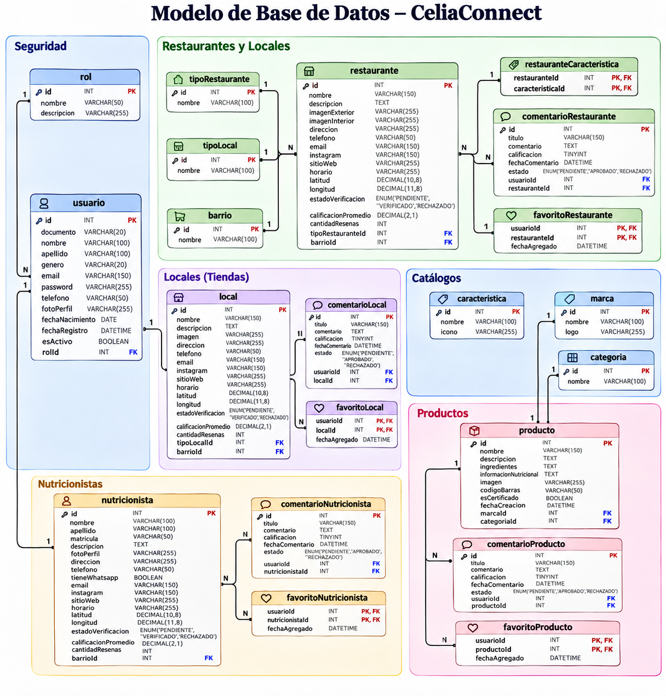
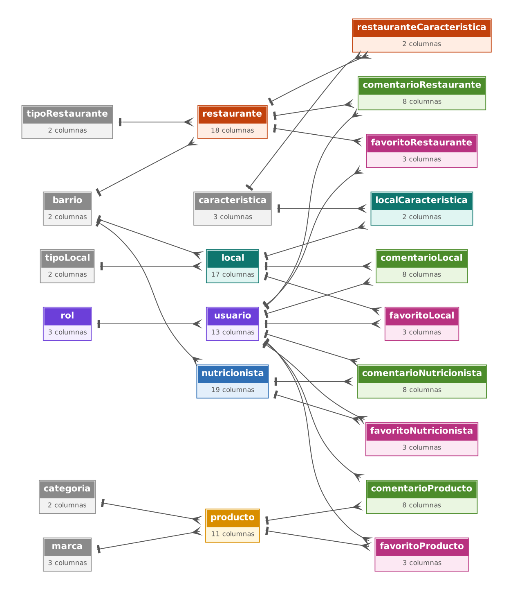
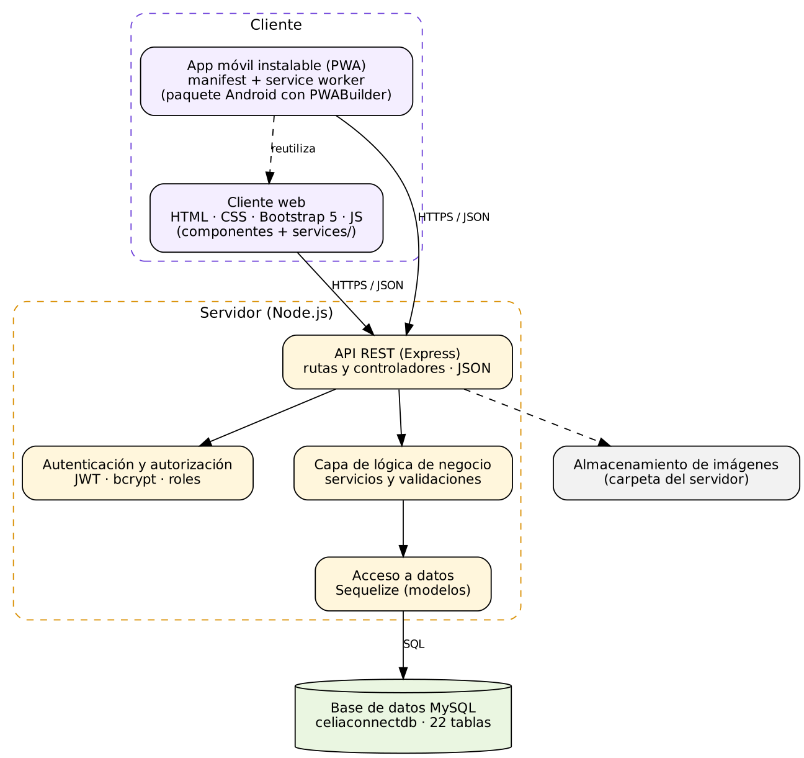
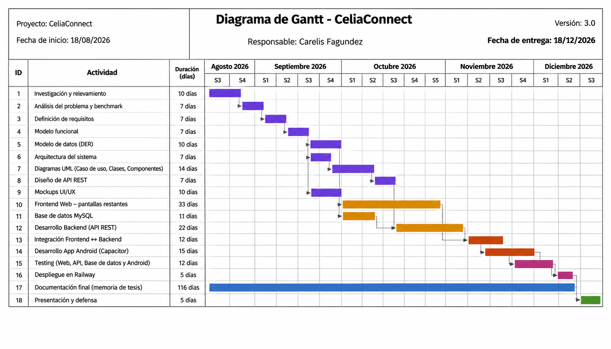

# 06 - Diagramas

## Información del documento

| Campo | Valor |
|---|---|
| Proyecto | CeliaConnect |
| Documento | Diagramas |
| Versión | 2.0 |
| Fecha | 08/10/2026 |
| Autor | Carelis Fagundez |
| Estado | En elaboración |

## 1. Introducción

El presente documento reúne los principales diagramas desarrollados durante las etapas de análisis y diseño de CeliaConnect. Cada uno representa una perspectiva distinta del sistema (datos, funcionalidades, arquitectura, clases y planificación) y sirve de guía para la construcción, las pruebas y el mantenimiento.

**Cambios de la versión 2.0:** la base de datos pasa a MySQL (antes se mencionaba SQL Server), se elimina el módulo de promociones, se incorporan favoritos y comentarios para los cuatro tipos de ítem (producto, restaurante, local y nutricionista), y la versión móvil se resuelve como PWA.

## 2. Diagrama Entidad-Relación (DER)

El DER representa el modelo lógico y físico de la base de datos `celiaconnectdb`, implementada en MySQL. Está compuesto por 22 tablas, organizadas en:

- **Usuarios:** `rol`, `usuario`.
- **Catálogos:** `barrio`, `categoria`, `marca`, `tipoRestaurante`, `tipoLocal`, `caracteristica`.
- **Contenido:** `producto`, `restaurante`, `local`, `nutricionista`, y las tablas intermedias `restauranteCaracteristica` y `localCaracteristica`.
- **Interacción:** `favoritoProducto`, `favoritoRestaurante`, `favoritoLocal`, `favoritoNutricionista` y `comentarioProducto`, `comentarioRestaurante`, `comentarioLocal`, `comentarioNutricionista`.

Reglas principales: los comentarios de un usuario no se pueden borrar en cascada (`ON DELETE RESTRICT` hacia `usuario`); al eliminar un ítem se eliminan sus comentarios y favoritos; los catálogos están protegidos con `RESTRICT`. Los comentarios tienen calificación de 1 a 5 y un estado (pendiente, aprobado, rechazado) para la moderación. Restaurantes, locales y nutricionistas tienen un estado de verificación.

Versión simplificada (solo tablas y relaciones):

## 3. Diagrama de Casos de Uso

El diagrama distingue tres actores: **Visitante** (sin sesión), **Usuario registrado** (hereda lo del visitante) y **Administrador** (hereda lo del usuario registrado y suma la gestión del sistema).

- **Visitante:** consultar inicio, productos, restaurantes, locales y nutricionistas; buscar y filtrar; ver detalle y reseñas; registrarse; iniciar sesión.
- **Usuario registrado:** gestionar favoritos, comentar y calificar, editar su perfil, cerrar sesión.
- **Administrador:** ver el panel, gestionar productos, restaurantes, locales, nutricionistas, catálogos y usuarios; moderar comentarios; verificar comercios y nutricionistas.

## 4. Diagrama de Componentes

La arquitectura es cliente-servidor desacoplada y en capas:

- **Cliente web** (HTML, CSS, Bootstrap 5 y JavaScript), con una capa `services/` que abstrae el origen de los datos.
- **App móvil instalable (PWA)**, que reutiliza el cliente web y se empaqueta para Android con PWABuilder.
- **API REST** (Node.js + Express) que responde en JSON.
- **Autenticación y autorización** con JWT, contraseñas con bcrypt y control por rol.
- **Capa de lógica de negocio** (servicios y validaciones).
- **Acceso a datos** con Sequelize.
- **Base de datos MySQL** y almacenamiento de imágenes en el servidor.

Este enfoque permite que cada componente evolucione de forma independiente.

## 5. Diagrama de Clases

Las clases se corresponden con las tablas del modelo de datos. Para mayor claridad, `Comentario` y `Favorito` se representan como una sola clase cada una, asociada a `Usuario` y a los cuatro tipos de ítem; en la base se guardan en cuatro tablas por tipo. Las tablas intermedias de características se representan como asociaciones muchos a muchos.

## 6. Diagrama de Gantt

La planificación toma como hitos la **entrega del trabajo final en la última semana de noviembre** y la **exposición el 18 de diciembre**. Las etapas de análisis, diseño de base de datos y las primeras pantallas del front ya están realizadas. Quedan por delante: front restante, backend, integración, PWA, publicación, pruebas y documentación, y luego la preparación de la exposición.

## 7. Próximos diagramas

Según las necesidades de la implementación podrán sumarse diagramas de secuencia (por ejemplo, inicio de sesión y publicación de un comentario), de actividad y de despliegue.

## 8. Consideraciones finales

Los diagramas son una representación del diseño actual y se actualizan si el sistema cambia. La fuente de verdad del modelo de datos es `database/schema.sql`.ón.
