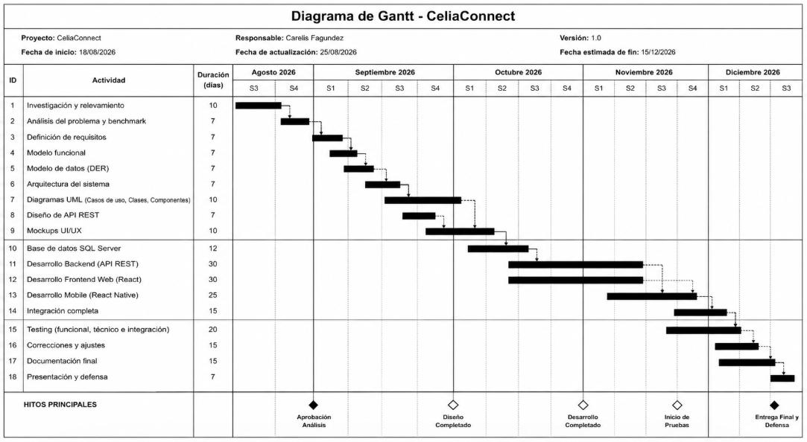

08 - Planificación del Proyecto (Gantt)
Información del documento
Campo	Valor
Proyecto	CeliaConnect
Documento	Planificación del Proyecto
Versión	1.1
Fecha	15/09/2026
Autor	Carelis Fagundez
Estado	En elaboración
1. Objetivo

El presente documento describe la planificación general del desarrollo de CeliaConnect mediante un diagrama de Gantt.

La planificación contempla las principales etapas del proyecto, desde el análisis inicial hasta la implementación, pruebas y defensa del trabajo final.

2. Diagrama de Gantt

3. Descripción de las etapas
Investigación

Relevamiento del problema a resolver (falta de información centralizada y confiable para personas celíacas), análisis de aplicaciones y sitios similares existentes en el mercado, y definición del enfoque general de CeliaConnect como plataforma centralizadora acotada a CABA para el MVP.

Análisis

Definición de los requisitos funcionales del sistema, identificación de los módulos (documento 01), los actores (Usuario y Administrador) y las reglas de negocio que rigen cada funcionalidad (documento 05).

Diseño

Elaboración del modelo de datos (documento 03), la arquitectura del sistema (documento 02) y los diagramas UML de apoyo (casos de uso, componentes, clases — documento 06), junto con el diseño de la API REST (documento 04) y los mockups de las pantallas (documento 09).

Desarrollo Backend

Implementación de la API REST con Node.js, Express y Sequelize sobre MySQL: modelos de datos, rutas, controladores, autenticación mediante JWT y lógica de negocio de cada módulo (Usuarios, Productos, Restaurantes, Locales, Nutricionistas, Promociones, Comentarios, Favoritos).

Desarrollo Frontend

Construcción de la interfaz web con HTML, CSS, Bootstrap 5.3.7 y JavaScript vanilla, inicialmente sobre datos mock (mocks/) para poder avanzar en paralelo al backend, y luego conectada a la API real a través de la capa services/.

Empaquetado PWA

Conversión del sitio publicado en una Progressive Web App (manifest.json + service worker) y generación del instalable Android mediante PWABuilder, reutilizando el 100% del frontend ya desarrollado.

Integración

Conexión completa entre el Frontend Web, la API REST y la base de datos MySQL, reemplazando los mocks por las llamadas reales a través de services/, y verificación de que todas las pantallas funcionen de punta a punta.

Testing

Pruebas funcionales de cada módulo, pruebas de integración entre frontend y backend, y validación de los casos de uso definidos en el documento 07 y los casos de prueba del documento 10.

Correcciones y ajustes

Resolución de bugs detectados durante el testing y ajustes finales de usabilidad y diseño antes de la entrega.

Documentación Final

Redacción de la memoria de tesis, consolidación de toda la documentación técnica (01 a 11) y preparación del material de apoyo para la defensa.

Presentación y Defensa

Preparación y presentación final del proyecto ante el tribunal evaluador de la carrera Analista de Sistemas (Instituto Da Vinci).
---
