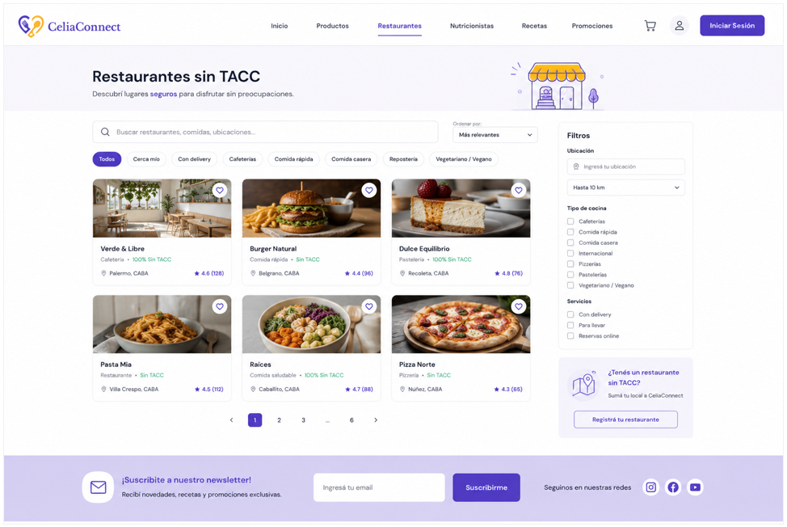
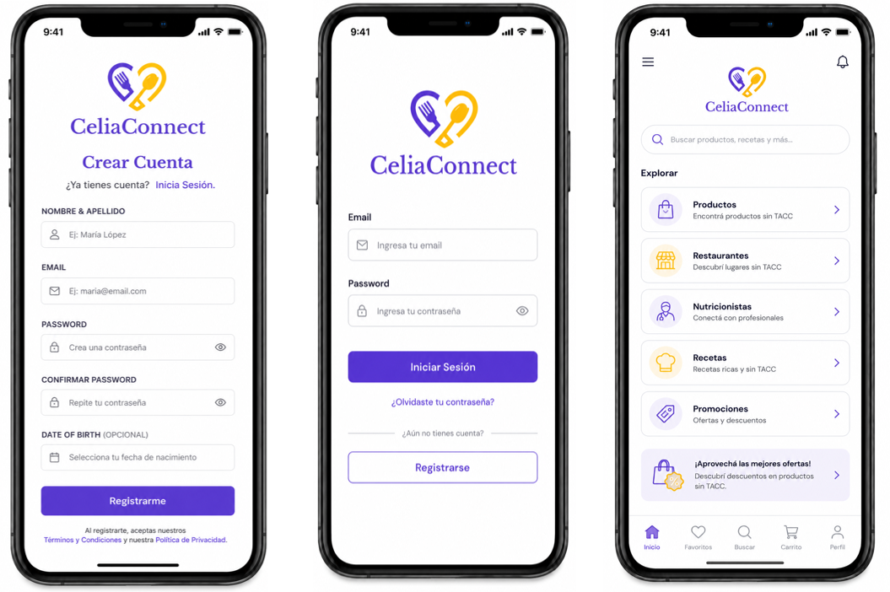

09 - Mockups
Información del documento
Campo	Valor
Proyecto	CeliaConnect
Documento	Mockups
Versión	1.1
Fecha	15/09/2026
Autor	Carelis Fagundez
Estado	En elaboración
1. Introducción

ℹ️ Nota de vigencia: estos mockups corresponden a una etapa temprana del proyecto (semestre anterior), previa a que se terminaran de definir el alcance y las decisiones actuales (stack, módulos, reglas de negocio). Donde haya diferencia entre este documento y lo ya construido en el frontend (login.html, registro.html, index.html, productos.html), el frontend construido es la referencia vigente, no el mockup. Este documento queda como registro histórico del diseño preliminar y guía general de estilo, no como especificación exacta a seguir para las pantallas que faltan.

Los siguientes mockups representan el diseño preliminar de la interfaz de usuario (UI) y la experiencia de usuario (UX) de CeliaConnect.

Su objetivo es ilustrar la apariencia y la organización de las principales pantallas que formarán parte de la aplicación web y mobile. Estos diseños sirven como referencia para la etapa de desarrollo, permitiendo validar la navegación, la distribución de los componentes y la interacción entre los distintos módulos del sistema antes de su implementación.

---

# 2. Mockups Web

## 2.1 Página de Inicio

### Descripción

La página principal presenta la propuesta de valor de CeliaConnect y permite acceder rápidamente a las principales funcionalidades de la plataforma, como productos, restaurantes, nutricionistas, recetas y promociones.

---

## 2.2 Inicio de Sesión

### Descripción

Pantalla destinada a la autenticación de usuarios registrados. Incluye acceso al registro de nuevos usuarios y recuperación de contraseña.

---

## 2.3 Restaurantes

### Descripción

Pantalla para consultar restaurantes aptos para personas celíacas mediante filtros, búsqueda y visualización de información relevante.

---

# 3. Mockups Mobile

### Descripción

Los mockups de la aplicación móvil presentan las principales pantallas diseñadas para CeliaConnect.

Las interfaces incluidas corresponden a:

- **Registro de usuario:** permite la creación de una nueva cuenta mediante un formulario simple e intuitivo.
- **Inicio de sesión:** posibilita la autenticación de usuarios registrados y el acceso a la recuperación de contraseña.
- **Pantalla principal:** ofrece acceso a los módulos principales de la aplicación, como Productos, Restaurantes, Nutricionistas, Recetas y Promociones, además de una barra de navegación inferior para facilitar la interacción del usuario.

El diseño sigue una línea visual consistente con la versión web, priorizando la simplicidad, la accesibilidad y una experiencia de usuario intuitiva.

---

# 4. Consideraciones

Los mockups presentados constituyen un diseño preliminar y podrán sufrir modificaciones durante la etapa de desarrollo para mejorar la experiencia del usuario y adaptarse a nuevos requerimientos funcionales.

Los cambios listados en la sección 1 deben aplicarse en el archivo de diseño original antes de tomarlos como referencia definitiva para las pantallas de Restaurantes y Locales que todavía están pendientes de desarrollo (ver README).
