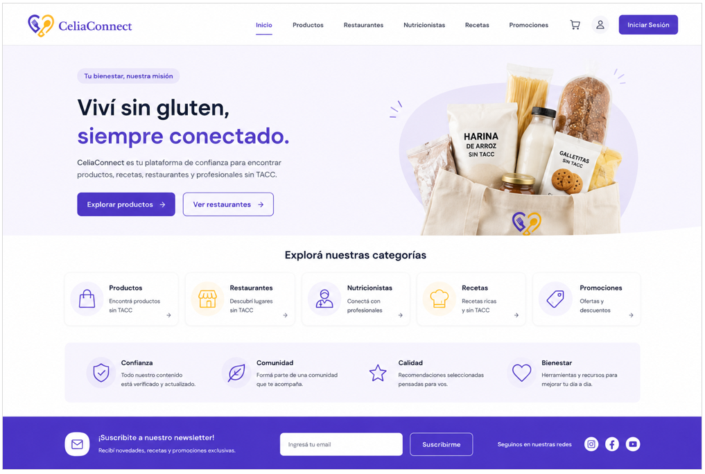
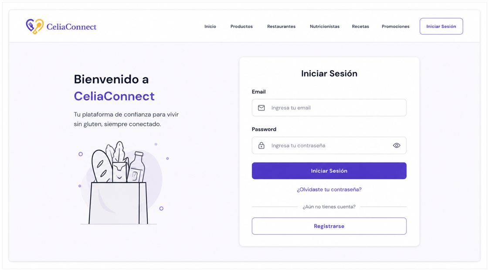

# 09 - Mockups

## Información del documento

| Campo | Valor |
|---|---|
| Proyecto | CeliaConnect |
| Documento | Mockups |
| Versión | 2.0 |
| Fecha | 12/11/2026 |
| Autor | Carelis Fagundez |
| Estado | Finalizado — Diseño preliminar documentado |

---

# 1. Introducción

Los mockups de CeliaConnect fueron elaborados durante las primeras etapas del proyecto con el objetivo de definir una propuesta visual inicial para la aplicación Web y Mobile.

Estos diseños permitieron explorar:

- Identidad visual.
- Distribución de componentes.
- Navegación.
- Jerarquía de información.
- Formularios.
- Catálogos.
- Adaptación entre Web y dispositivos móviles.

Los mockups constituyen una **referencia del proceso de diseño** y no una representación exacta de la versión final implementada.

Durante el desarrollo, CeliaConnect evolucionó funcional y técnicamente, por lo que algunas características representadas en los diseños preliminares fueron modificadas, reemplazadas o excluidas del MVP final.

La aplicación implementada constituye la referencia vigente del comportamiento y diseño final del sistema.

---

# 2. Objetivo de los mockups

Los mockups tuvieron como objetivo:

- Definir una identidad visual inicial.
- Evaluar la organización de las pantallas.
- Representar los principales flujos de navegación.
- Diseñar formularios de autenticación.
- Representar la visualización de contenido.
- Analizar la adaptación de la interfaz a dispositivos móviles.
- Servir como referencia durante el desarrollo del frontend.

---

# 3. Identidad visual

Desde las primeras propuestas se establecieron elementos visuales que posteriormente fueron utilizados como base de CeliaConnect.

Entre ellos:

- Logo de CeliaConnect.
- Uso predominante de tonos violetas.
- Uso complementario de tonos amarillos/naranjas.
- Fondos claros.
- Tarjetas para representar contenido.
- Diseño simple y accesible.
- Formularios con estructura visual uniforme.
- Identificación gráfica relacionada con alimentación Sin TACC.

Aunque la interfaz evolucionó durante el desarrollo, la identidad general definida en los mockups sirvió como referencia para la versión implementada.

---

# 4. Mockups Web

## 4.1 Página de Inicio



### Descripción

El mockup de la página principal representa una propuesta inicial de acceso a CeliaConnect.

La pantalla fue diseñada para:

- Presentar la identidad de la plataforma.
- Comunicar la propuesta de valor.
- Facilitar el acceso a los principales módulos.
- Proporcionar navegación hacia las distintas secciones.

Durante el desarrollo se realizaron modificaciones sobre la estructura y los módulos disponibles para adaptarlos al alcance definitivo del MVP.

---

## 4.2 Inicio de Sesión



### Descripción

El mockup de inicio de sesión fue diseñado para representar el acceso de usuarios registrados.

Incluye:

- Campo de email.
- Campo de contraseña.
- Botón de inicio de sesión.
- Acceso al registro.
- Identidad visual de CeliaConnect.

El diseño preliminar también contemplaba una opción de recuperación de contraseña.

Esta funcionalidad finalmente quedó **fuera del alcance del MVP implementado**.

La pantalla definitiva conserva el objetivo principal del mockup: permitir la autenticación de usuarios mediante una interfaz clara y sencilla.

---

## 4.3 Restaurantes


### Descripción

El mockup de Restaurantes representa una propuesta inicial para la consulta de establecimientos gastronómicos.

El diseño contempla elementos como:

- Buscador.
- Filtros.
- Tarjetas de restaurantes.
- Imágenes.
- Ubicación.
- Tipo de establecimiento.
- Calificaciones.
- Navegación.
- Acceso a favoritos.

Esta propuesta sirvió como referencia conceptual durante el desarrollo del módulo real de Restaurantes.

La implementación final fue adaptada a los datos, funcionalidades y requerimientos definitivos de CeliaConnect.

---

# 5. Mockups Mobile


Los mockups Mobile fueron creados para estudiar cómo podía adaptarse CeliaConnect a dispositivos móviles.

Las pantallas diseñadas incluyen:

- Registro.
- Inicio de sesión.
- Página principal.

---

## 5.1 Registro Mobile

La propuesta de registro incluye:

- Logo.
- Nombre de la plataforma.
- Datos personales.
- Email.
- Contraseña.
- Confirmación de contraseña.
- Fecha de nacimiento.
- Acceso al inicio de sesión.

El objetivo fue diseñar un formulario sencillo y legible para pantallas pequeñas.

---

## 5.2 Login Mobile

La pantalla de inicio de sesión contempla:

- Logo.
- Email.
- Contraseña.
- Botón de inicio de sesión.
- Acceso al registro.

El mockup también incluía recuperación de contraseña, funcionalidad que finalmente no forma parte del MVP.

---

## 5.3 Home Mobile

La propuesta inicial de Home Mobile incluía accesos a diferentes categorías mediante tarjetas.

Entre los módulos representados originalmente se encontraban:

- Productos.
- Restaurantes.
- Nutricionistas.
- Recetas.
- Promociones.

Durante la definición final del alcance, **Recetas y Promociones dejaron de formar parte del MVP**.

La versión implementada se concentra en:

- Productos.
- Restaurantes.
- Locales.
- Nutricionistas.
- Favoritos.
- Comentarios y calificaciones.
- Funcionalidades asociadas a la cuenta del usuario.

---

# 6. Evolución de los mockups

Los mockups corresponden a una etapa anterior a la implementación definitiva.

Por este motivo existen diferencias entre algunos elementos representados gráficamente y el sistema actual.

| Mockup inicial | Implementación final |
|---|---|
| Productos | Implementado |
| Restaurantes | Implementado |
| Nutricionistas | Implementado |
| Locales no destacados como módulo principal | Implementado como módulo principal |
| Recetas | Fuera del MVP |
| Promociones | Fuera del MVP |
| Recuperación de contraseña | Fuera del MVP |
| Favoritos | Implementado y ampliado |
| Comentarios limitados | Implementados en los principales módulos |
| Moderación no representada | Implementada |
| Administrador | Implementado |
| Moderador | Implementado |
| Dashboard no representado | Implementado |

Esta evolución responde al proceso iterativo del proyecto y a la definición progresiva del alcance del MVP.

---

# 7. De Mobile preliminar a aplicación Android

Los mockups Mobile fueron realizados antes de seleccionar definitivamente la tecnología utilizada para distribuir CeliaConnect como aplicación móvil.

Inicialmente se evaluó una estrategia basada en PWA.

Posteriormente se decidió utilizar **Capacitor** para generar una aplicación Android a partir del frontend responsive existente.

La arquitectura final es:

```text id="6gdb1s"
Frontend Responsive
        ↓
     Capacitor
        ↓
     Android
        ↓
    API REST
        ↓
      MySQL
```

La aplicación Android mantiene la identidad visual y las funcionalidades principales de la versión Web.

---

# 8. Diseño responsive

Una de las decisiones adoptadas durante el desarrollo fue utilizar una única interfaz Web responsive como base de la experiencia en diferentes dispositivos.

El frontend se adapta a:

- Desktop.
- Tablets.
- Teléfonos móviles.

Esta estrategia permitió reutilizar el frontend dentro de la aplicación Android mediante Capacitor.

Por este motivo, la versión Android final no reproduce exactamente las pantallas de los mockups Mobile originales, sino que utiliza la versión responsive del sistema implementado.

---

# 9. Relación entre diseño e implementación

El proceso seguido puede resumirse de la siguiente manera:

```text id="kvsj8e"
Wireframes
    ↓
Mockups
    ↓
Prototipo visual
    ↓
Desarrollo Frontend
    ↓
Pruebas responsive
    ↓
Ajustes de UI/UX
    ↓
Aplicación Web
    ↓
Aplicación Android
```

Los mockups funcionaron como punto de partida y permitieron establecer una dirección visual antes de comenzar la implementación completa.

---

# 10. Diferencias respecto del diseño preliminar

Durante el desarrollo se realizaron cambios como consecuencia de:

- Ajustes de alcance.
- Evolución de los requisitos.
- Incorporación de nuevas funcionalidades.
- Implementación de roles.
- Incorporación de moderación.
- Incorporación de favoritos para los distintos módulos.
- Incorporación de comentarios y calificaciones.
- Necesidad de mantener una interfaz responsive.
- Integración con datos reales.
- Adaptación de la interfaz para Android.

Estos cambios forman parte natural del proceso iterativo de desarrollo de software.

---

# 11. Estado actual

Los mockups incluidos en este documento se conservan como **registro del proceso de diseño de CeliaConnect**.

No es necesario que coincidan exactamente con la aplicación final, ya que representan una etapa previa del proyecto.

La referencia actual para la interfaz y comportamiento del sistema corresponde a:

- Aplicación Web implementada.
- Aplicación Android.
- Modelo funcional.
- Casos de uso.
- Requisitos funcionales.

La aplicación Web se encuentra disponible en:

```text id="6euk88"
https://celiaconnect.up.railway.app
```

---

# 12. Consideraciones finales

Los mockups permitieron validar inicialmente la estructura, identidad visual y navegación propuesta para CeliaConnect antes de completar el desarrollo.

La comparación entre los diseños preliminares y el producto implementado permite observar la evolución del proyecto desde la etapa conceptual hasta un MVP funcional.

Las diferencias existentes entre los mockups y la aplicación final no representan inconsistencias de documentación, sino decisiones tomadas durante el proceso iterativo de análisis, diseño, implementación y validación.

---

# 13. Estado del documento

**Versión:** 2.0

**Estado:** Finalizado — Diseño preliminar documentado.

Los mockups se conservan como evidencia de la etapa de diseño y como parte de la documentación del proceso de desarrollo de CeliaConnect.