# CeliaConnect – Manual de Usuario Web

**Versión:** 1.0  
**Año:** 2026  
**Plataforma:** Web  
**Proyecto:** CeliaConnect  

---

## 1. Introducción

CeliaConnect es una plataforma desarrollada con el objetivo de facilitar el acceso a información relacionada con productos y servicios orientados a personas que necesitan llevar una alimentación libre de gluten.

La aplicación reúne en un mismo espacio información sobre productos Sin TACC, restaurantes, locales comerciales y profesionales de nutrición, permitiendo realizar búsquedas y consultar información detallada de cada opción.

Este manual describe las principales funcionalidades disponibles en la versión web de CeliaConnect y explica cómo utilizarlas.

---

## 2. Acceso a CeliaConnect

CeliaConnect puede utilizarse desde un navegador web en computadoras, tablets y dispositivos móviles.

Para ingresar a la plataforma, el usuario debe acceder a la dirección web correspondiente a CeliaConnect.

Al ingresar se presenta la página principal, desde donde es posible navegar por las diferentes secciones de la aplicación.

---

## 3. Página principal

La página principal permite acceder rápidamente a las principales funcionalidades de CeliaConnect.

Desde el menú de navegación se encuentran disponibles las distintas categorías de información ofrecidas por la plataforma, entre ellas:

- Productos.
- Restaurantes.
- Locales.
- Nutricionistas.

La interfaz fue diseñada para facilitar la navegación y permitir que el usuario encuentre rápidamente la información que necesita.

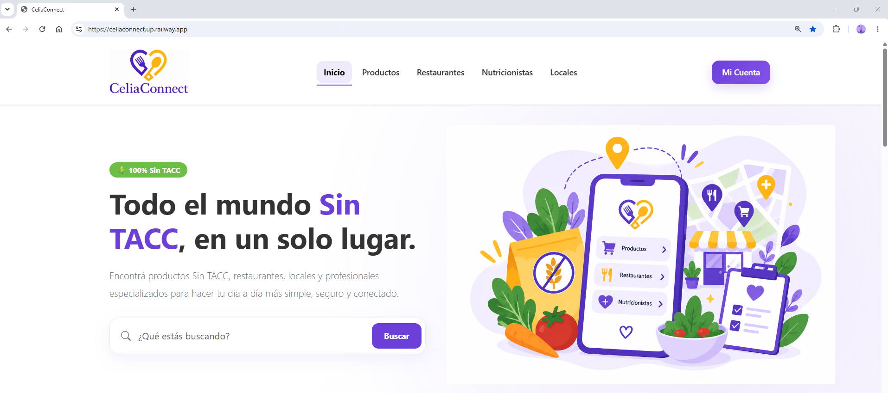

---

## 4. Registro de usuario

Para utilizar las funcionalidades asociadas a una cuenta personal, el usuario puede registrarse en CeliaConnect.

Para crear una cuenta:

1. Seleccionar la opción **Registrarse**.
2. Completar los datos solicitados en el formulario.
3. Ingresar una dirección de correo electrónico válida.
4. Definir una contraseña.
5. Confirmar el registro.

El sistema valida los datos ingresados antes de crear la cuenta.

Una vez completado correctamente el proceso, el usuario podrá utilizar sus credenciales para iniciar sesión.

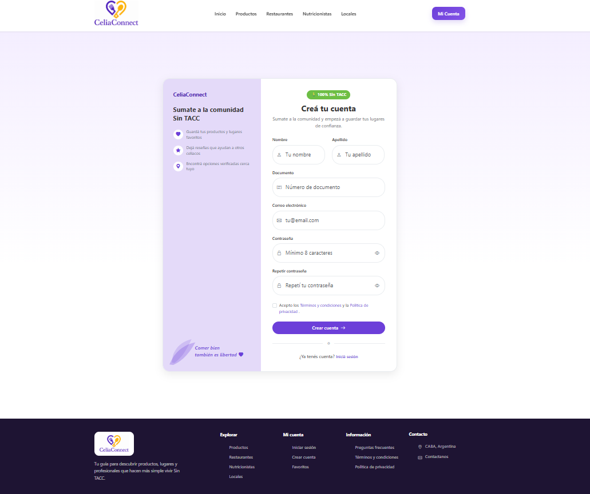

---

## 5. Inicio de sesión

Los usuarios registrados pueden acceder a su cuenta desde la pantalla de inicio de sesión.

Para iniciar sesión:

1. Seleccionar la opción **Iniciar sesión**.
2. Ingresar el correo electrónico utilizado durante el registro.
3. Ingresar la contraseña.
4. Presionar el botón **Iniciar sesión**.

Si las credenciales son correctas, el sistema permitirá el acceso a la cuenta.

En caso de ingresar datos incorrectos, CeliaConnect mostrará un mensaje informando que no fue posible iniciar sesión.

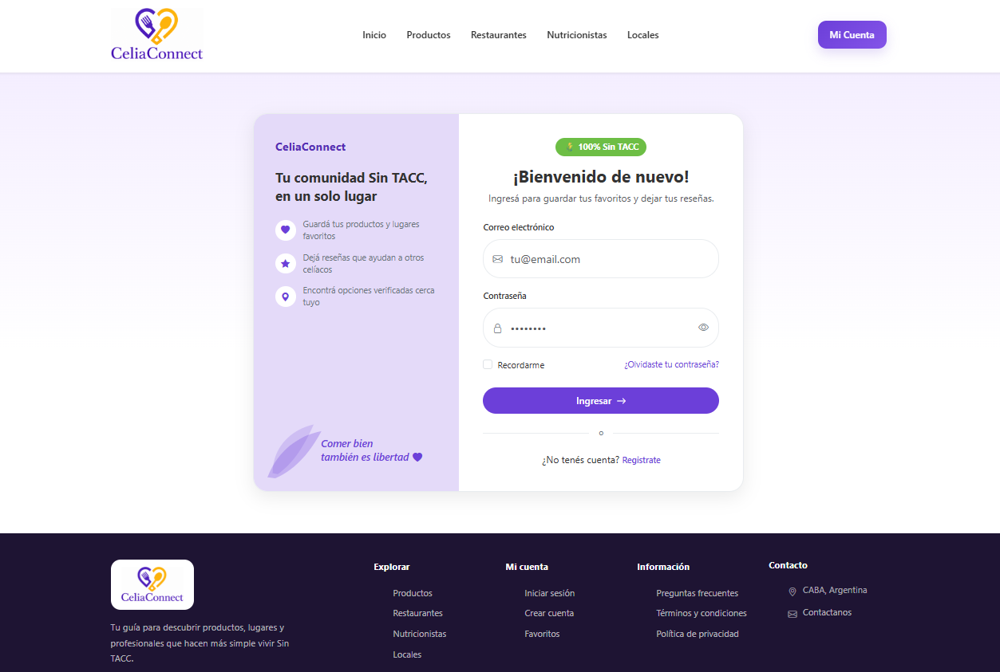

---

## 6. Consulta de productos

La sección **Productos** permite consultar el catálogo de productos registrados en CeliaConnect.

Cada producto se presenta mediante una tarjeta que permite identificar rápidamente información relevante.

Para consultar los productos:

1. Ingresar a la sección **Productos** desde el menú.
2. Explorar el listado disponible.
3. Utilizar las herramientas de búsqueda o filtrado si se desea encontrar un producto específico.
4. Seleccionar una tarjeta para acceder al detalle completo del producto.

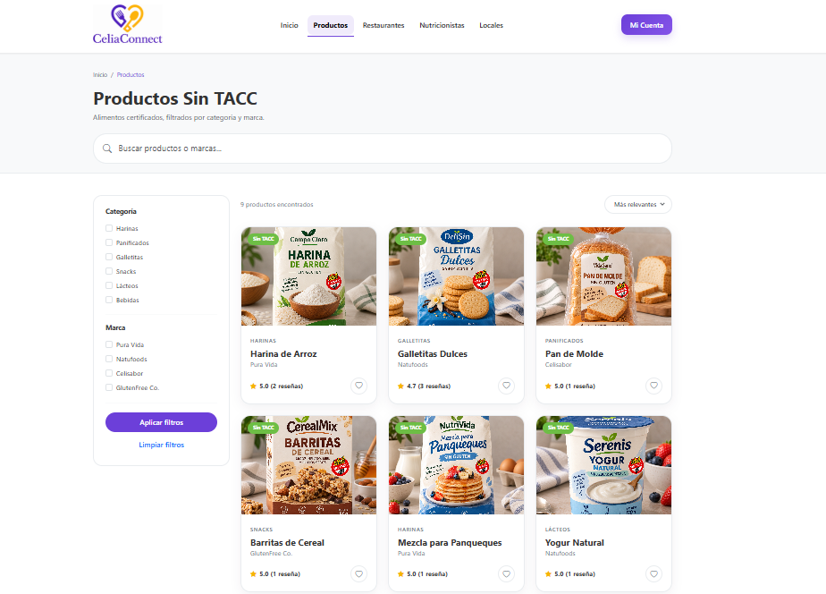

---

## 7. Búsqueda de productos

CeliaConnect dispone de una herramienta de búsqueda que permite localizar productos dentro del catálogo.

El usuario puede ingresar el nombre de un producto, una marca o un término relacionado en el campo de búsqueda. El sistema actualizará los resultados de acuerdo con el criterio ingresado.

Esta funcionalidad permite encontrar productos de forma rápida sin necesidad de recorrer todo el catálogo.

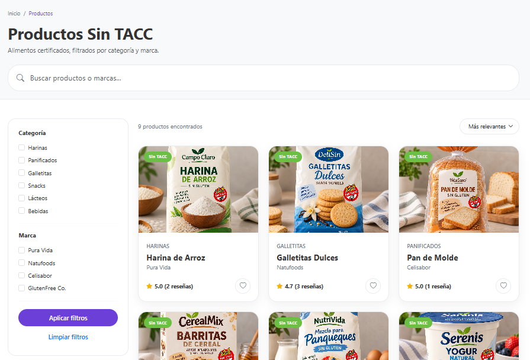

---

## 8. Ordenamiento de productos

La sección de productos dispone de opciones de ordenamiento para facilitar la exploración del catálogo.

Todos los productos publicados en CeliaConnect corresponden a productos Sin TACC, por lo que no es necesario aplicar un filtro específico para esta característica.

El usuario puede utilizar las opciones de ordenamiento disponibles para organizar los productos y localizar con mayor facilidad la información que desea consultar.

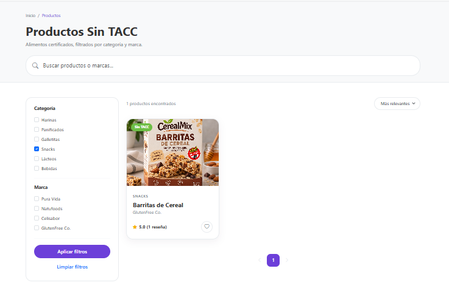

---

## 9. Paginación del catálogo

Cuando existen numerosos productos, locales, registrados y nutriconistas registrados, CeliaConnect distribuye los resultados en diferentes páginas.

El catálogo muestra una cantidad limitada de productos por página y permite desplazarse entre ellas mediante los controles de paginación ubicados al final del listado.

Esto facilita la navegación y evita presentar una cantidad excesiva de información en una única pantalla.

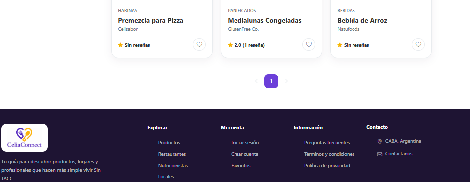

---

## 10. Detalle de producto

Para acceder a la información completa de un producto, el usuario debe seleccionar su tarjeta dentro del catálogo.

La pantalla de detalle presenta la información disponible del producto, que puede incluir:

- Nombre.
- Marca.
- Categoría.
- Descripción.
- Ingredientes.
- Información nutricional.
- Código de barras.

Los productos incluidos en el catálogo de CeliaConnect corresponden a opciones Sin TACC.

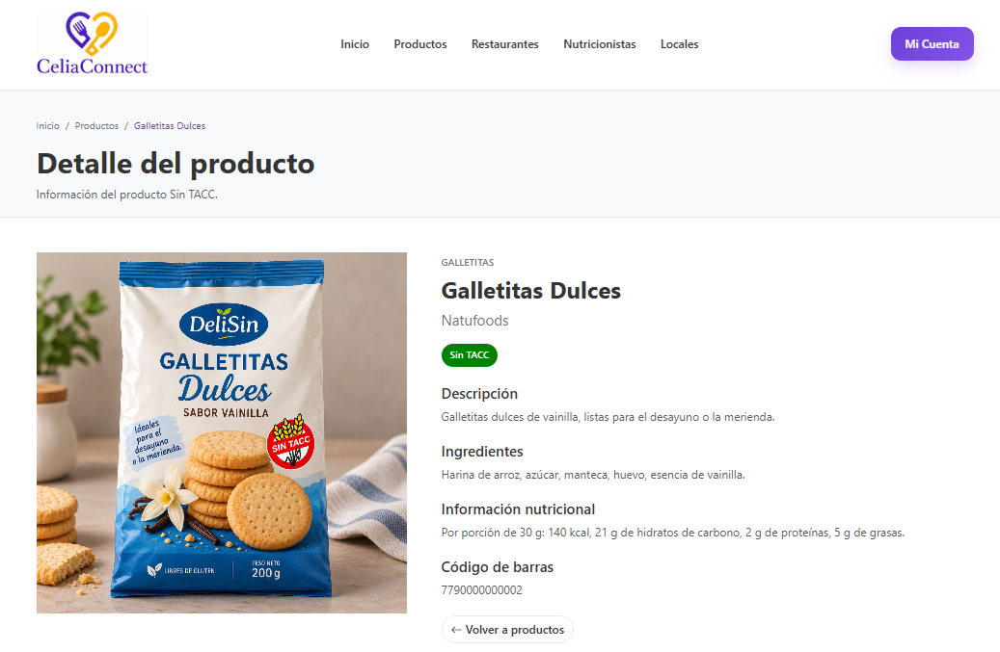

---

## 11. Restaurantes

La sección **Restaurantes** permite consultar establecimientos gastronómicos incluidos en CeliaConnect.

Para consultar un restaurante:

1. Seleccionar **Restaurantes** desde el menú principal.
2. Explorar los establecimientos disponibles.
3. Seleccionar el restaurante de interés.
4. Consultar su información detallada.

De esta manera, el usuario puede acceder desde una misma plataforma a información sobre diferentes opciones gastronómicas.

> **Listado de restaurantes** 

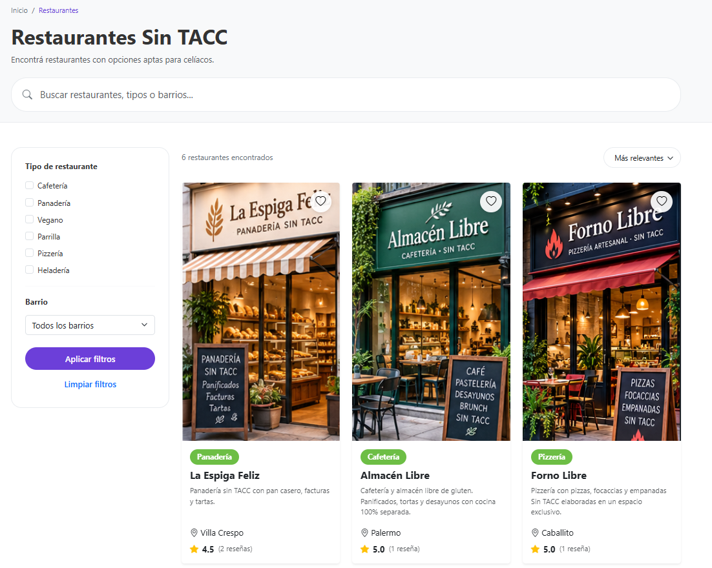

> **Detalle de un restaurante** 

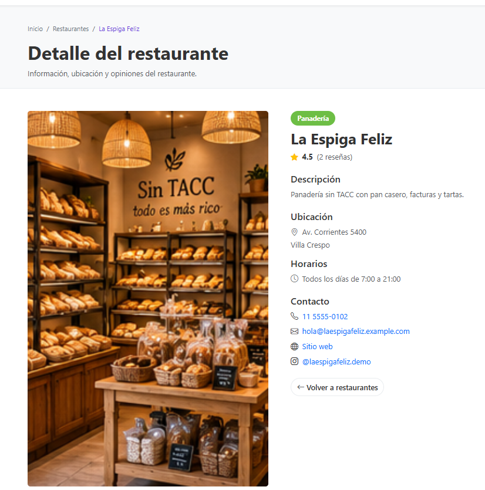

---

## 12. Locales

La sección **Locales** reúne comercios relacionados con productos aptos para personas que requieren una alimentación libre de gluten.

Para consultar un local:

1. Seleccionar **Locales** desde el menú principal.
2. Explorar los comercios disponibles por el buscador.
3. Seleccionar el local de interés.
4. Consultar su información detallada.

Esta funcionalidad permite centralizar información sobre diferentes puntos de venta dentro de CeliaConnect.

> **Listado de locales**

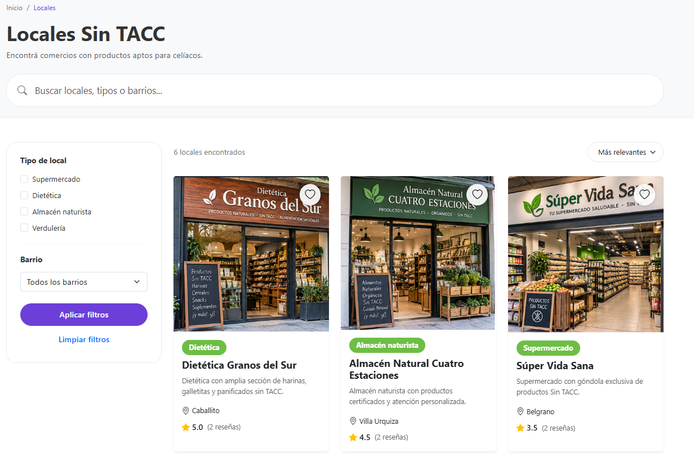

> **Detalle de un local** 

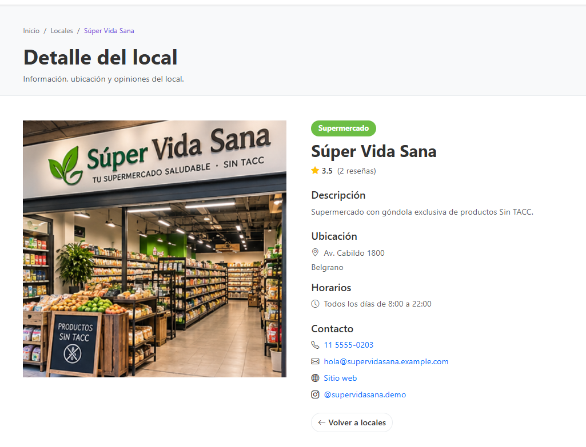

---

## 13. Nutricionistas

La sección **Nutricionistas** permite consultar profesionales incluidos en el directorio de CeliaConnect.

Para consultar un profesional:

1. Seleccionar **Nutricionistas** desde el menú principal.
2. Explorar los profesionales disponibles.
3. Seleccionar el nutricionista de interés.
4. Consultar la información disponible en su perfil.

Esta sección facilita el acceso a información sobre profesionales vinculados con la nutrición.

> **Listado de nutricionistas**

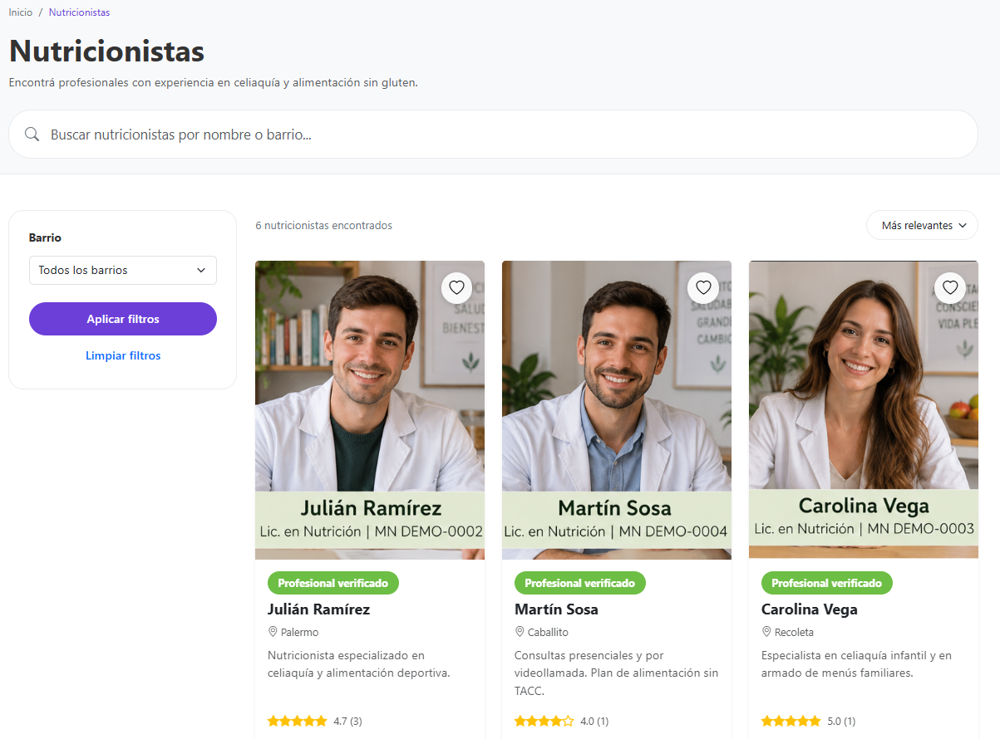

> **Detalle de un nutricionista**

---

## 14. Comentarios y calificaciones

CeliaConnect permite a los usuarios registrados compartir su experiencia mediante comentarios y calificaciones.

También es posible consultar las opiniones que hayan sido aprobadas y publicadas en la plataforma.

Para dejar una opinión:

1. Iniciar sesión en CeliaConnect.
2. Acceder al elemento que se desea valorar.
3. Seleccionar la opción para dejar una opinión.
4. Elegir una calificación.
5. Escribir el comentario.
6. Enviar la opinión.

Los comentarios enviados pasan por un proceso de moderación antes de ser publicados, con el objetivo de mantener contenido adecuado dentro de la plataforma.

> **Formulario para dejar una opinión:** 

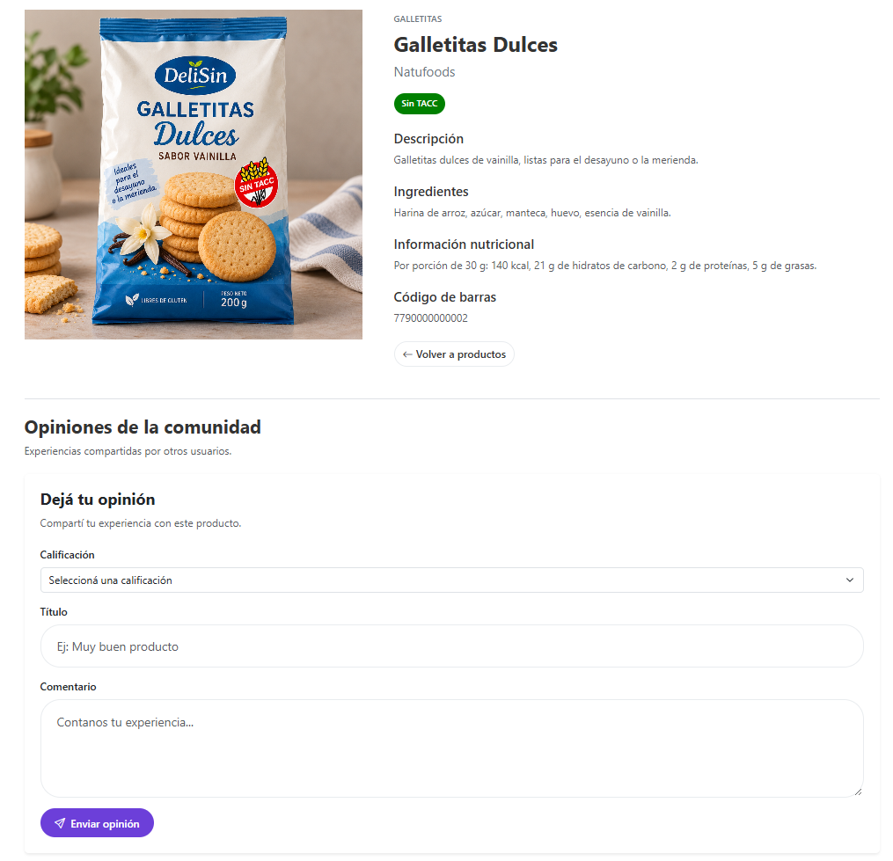 

> **Sección de comentarios y calificaciones** 

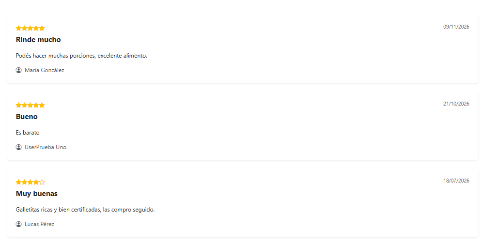

---

## 15. Favoritos

Los usuarios registrados pueden guardar elementos de interés mediante la funcionalidad de favoritos.

Para acceder a los elementos guardados:

Iniciar sesión en CeliaConnect.

Seleccionar el menú correspondiente al usuario en la parte superior de la pantalla.

Seleccionar la opción Mis favoritos.

El sistema mostrará los elementos guardados por el usuario.

Los elementos seleccionados como favoritos quedan asociados a la cuenta del usuario, permitiendo acceder nuevamente a ellos de manera rápida.

> **Acceso a favoritos**
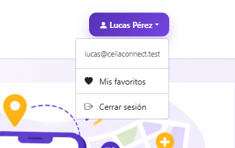

> **Marcar como favorito**
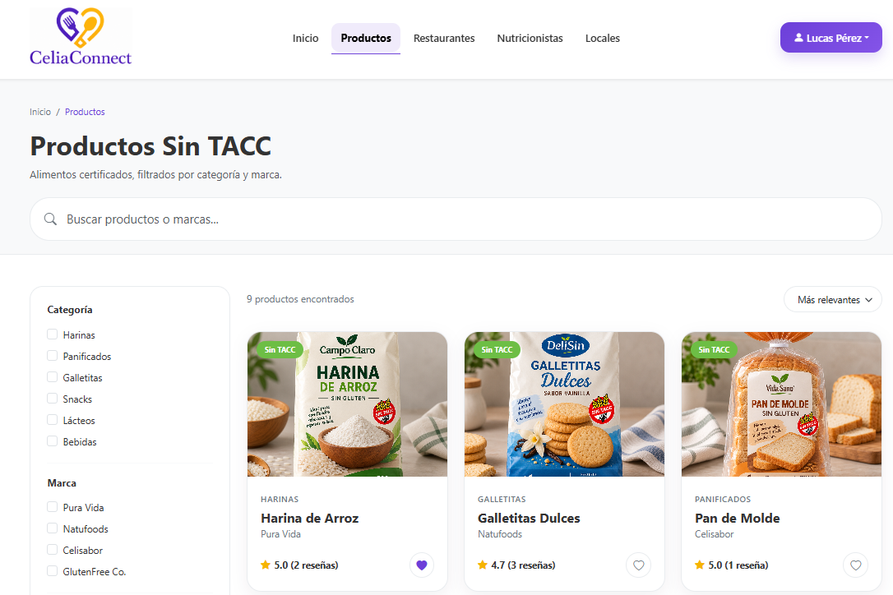

> **Mis favoritos**
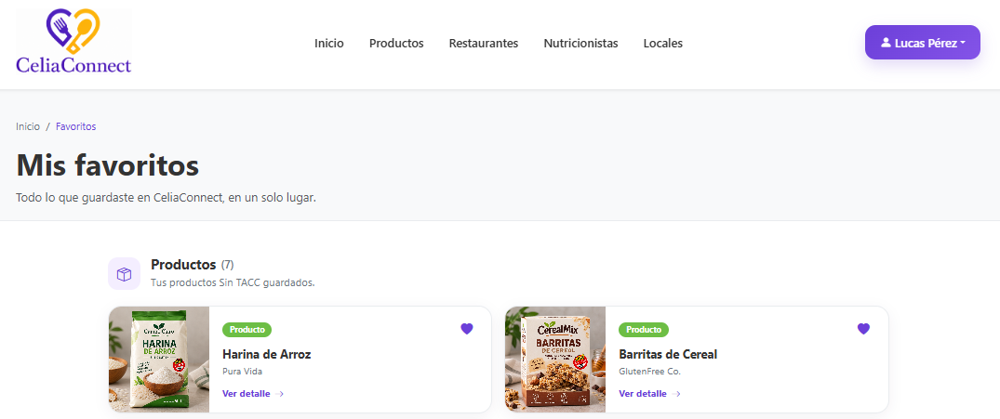

---

## 16. Navegación desde dispositivos móviles

La versión web de CeliaConnect cuenta con un diseño adaptable que permite utilizar la plataforma desde dispositivos con diferentes tamaños de pantalla.

Al acceder desde un teléfono móvil, la interfaz se ajusta automáticamente para facilitar la navegación, la lectura del contenido y el acceso a las principales funcionalidades.

De esta manera, el usuario puede consultar CeliaConnect desde el navegador de su dispositivo móvil manteniendo una experiencia de navegación adecuada.

> **Vista Mobile desde web 1**

> **Vista Mobile desde web 2**

---

## 17. Cierre de sesión

Cuando el usuario finaliza el uso de su cuenta, puede utilizar la opción **Cerrar sesión**.

Al hacerlo, se finaliza la sesión activa y la plataforma vuelve al estado de navegación sin autenticación.

Se recomienda cerrar sesión especialmente cuando CeliaConnect se utiliza desde un dispositivo compartido.

> **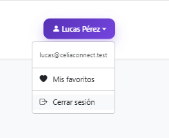**

---

## 18. Mensajes y validaciones

Durante la utilización de CeliaConnect, el sistema muestra diferentes mensajes para informar al usuario sobre el resultado de las acciones realizadas.

Entre ellos pueden encontrarse:

- Campos obligatorios sin completar.
- Datos de acceso incorrectos.
- Operaciones realizadas correctamente.
- Errores al procesar una solicitud.
- Ausencia de resultados para una búsqueda.
- Confirmaciones de acciones realizadas.

Estos mensajes permiten conocer el estado de cada operación y facilitan la interacción con la plataforma.

> **Mensaje de error por validación** 
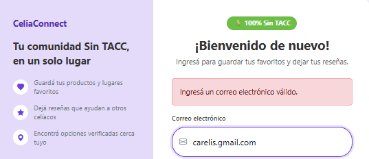

> **Mensaje satisfactorio** 
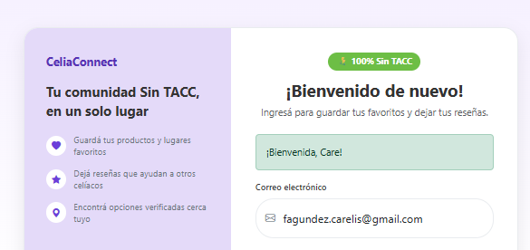

---

## 19. Recomendaciones de uso

Para una mejor experiencia de navegación se recomienda:

- Utilizar un navegador web actualizado.
- Mantener una conexión a Internet estable.
- Ingresar información válida durante el registro.
- Mantener las credenciales de acceso de forma segura.
- Utilizar las herramientas de búsqueda y ordenamiento para localizar información con mayor rapidez.
- Cerrar sesión cuando se utilice un dispositivo compartido.

---

## 20. Recuperación de contraseña

CeliaConnect contempla una funcionalidad para permitir que un usuario recupere el acceso a su cuenta cuando no recuerda su contraseña.

Desde la pantalla de inicio de sesión, el usuario podrá seleccionar la opción **¿Olvidaste tu contraseña?**, ingresar el correo electrónico asociado a su cuenta y solicitar un enlace para establecer una nueva contraseña.

El enlace de recuperación será enviado al correo electrónico registrado y tendrá una validez limitada por motivos de seguridad.

> **Pantalla de recuperación de contraseña**
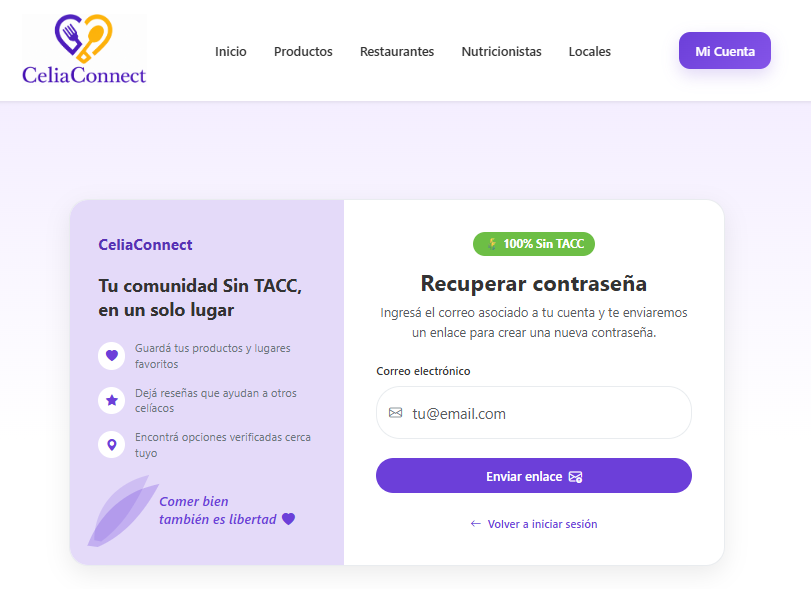

---

## 21. Consideraciones finales

CeliaConnect centraliza información relacionada con productos Sin TACC, restaurantes, locales y profesionales de nutrición, facilitando su consulta desde una única plataforma.

Además de explorar la información disponible, los usuarios registrados pueden acceder a funcionalidades personalizadas, como comentarios, calificaciones y favoritos.

La plataforma fue diseñada con una interfaz adaptable para facilitar su utilización tanto desde computadoras como desde dispositivos móviles.

---

**CeliaConnect – Manual de Usuario Web**  
**Versión 1.0 – 2026**