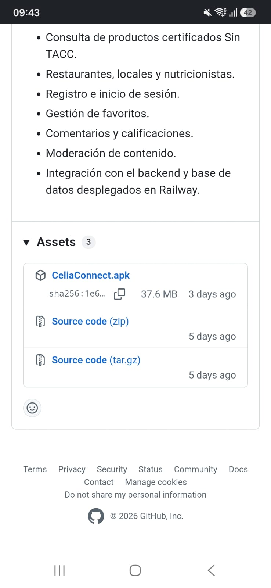
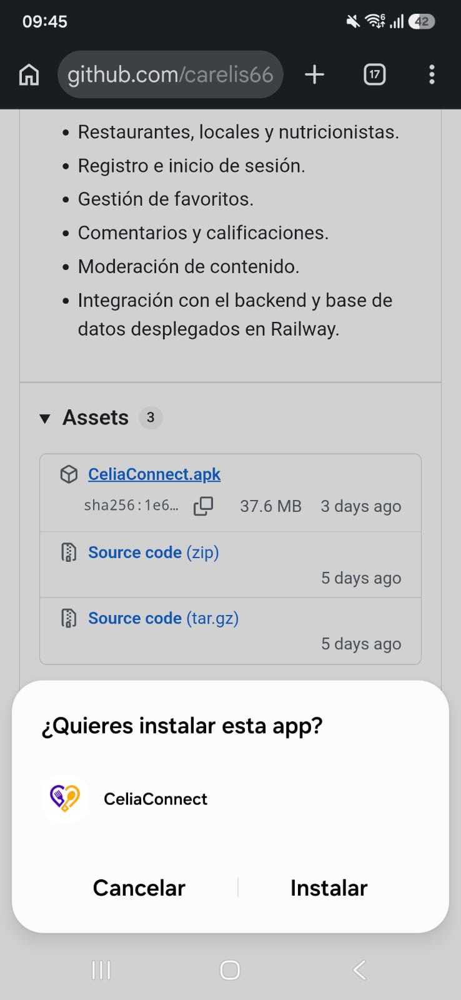
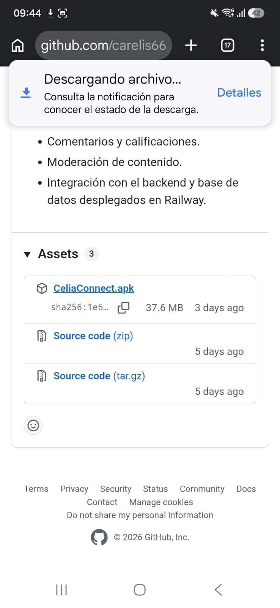
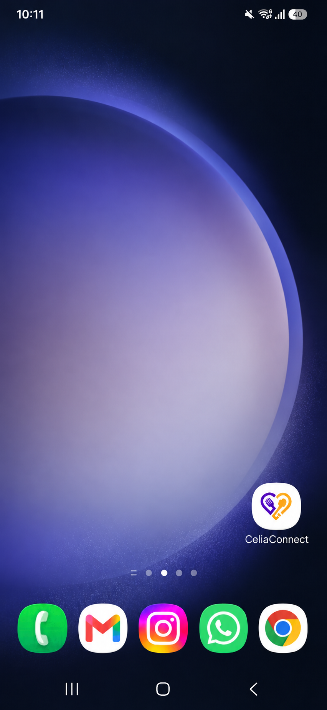
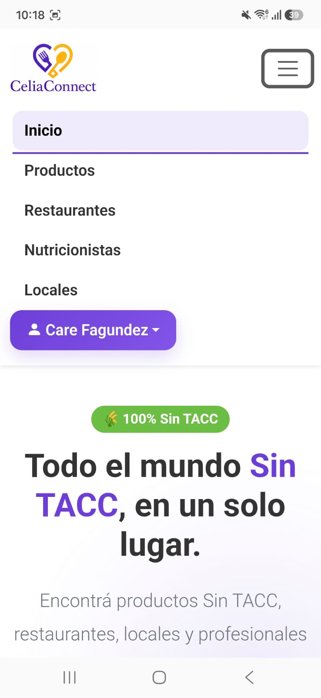
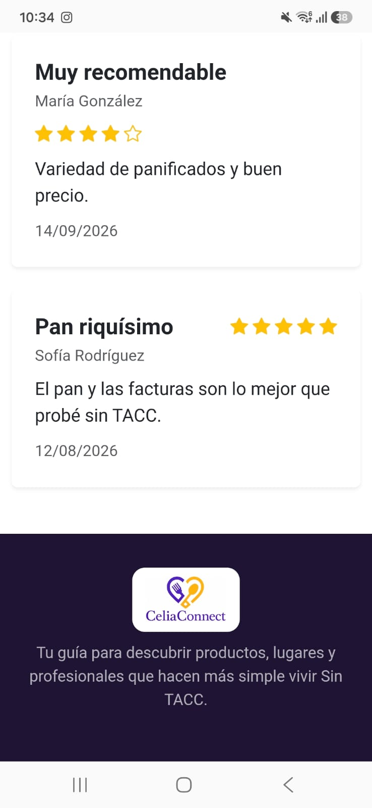
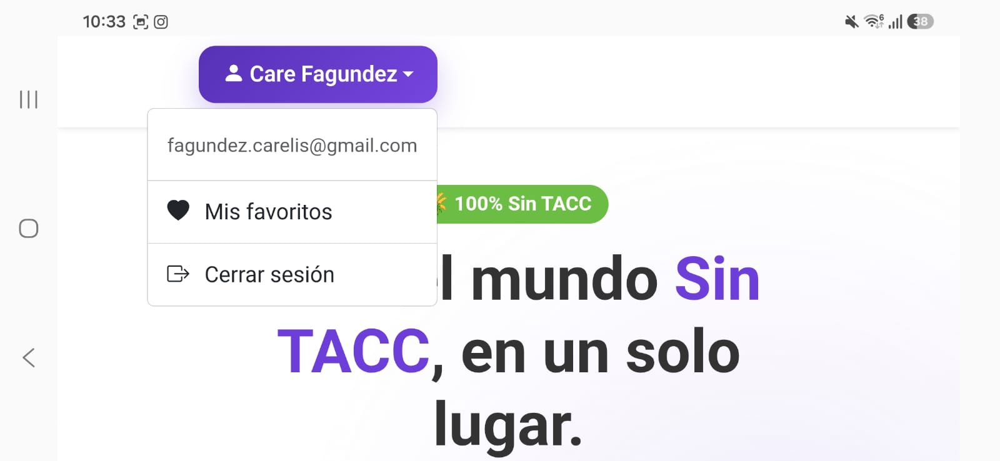

# CeliaConnect – Manual de Usuario Android

**Versión:** 1.0  
**Año:** 2026  
**Plataforma:** Android  
**Proyecto:** CeliaConnect  

---

## 1. Introducción

CeliaConnect cuenta con una versión para dispositivos Android que permite acceder desde un teléfono móvil a las principales funcionalidades de la plataforma.

La aplicación permite consultar información sobre productos Sin TACC, restaurantes, locales y profesionales de nutrición, además de utilizar las funcionalidades disponibles para usuarios registrados.

La versión Android fue desarrollada a partir de la plataforma web de CeliaConnect mediante **Capacitor** y Android Studio, permitiendo generar una aplicación instalable en dispositivos Android mediante un archivo APK.

La aplicación utiliza los mismos servicios de CeliaConnect que la versión web, por lo que la información disponible se mantiene integrada entre ambas plataformas.

Este manual explica el proceso de descarga, instalación y utilización de CeliaConnect desde un dispositivo Android.

---

## 2. Requisitos para utilizar la aplicación

Para utilizar CeliaConnect en Android se requiere:

- Un dispositivo con sistema operativo Android.
- Conexión a Internet.
- El archivo APK de CeliaConnect.
- Permiso para instalar aplicaciones mediante archivos APK.
- Una cuenta registrada en CeliaConnect para acceder a las funcionalidades que requieren autenticación.

La conexión a Internet es necesaria para consultar la información disponible en la plataforma y utilizar las funcionalidades que se comunican con los servicios de CeliaConnect.

---

## 3. Descarga de CeliaConnect

La versión Android de CeliaConnect se distribuye mediante un archivo **APK**.

La versión **CeliaConnect v1.0.0** se encuentra publicada como una Release dentro del repositorio del proyecto en GitHub.

Para obtener la aplicación:

1. Acceder al repositorio de CeliaConnect en GitHub.
2. Ingresar a la sección **Releases**.
3. Seleccionar la versión correspondiente de CeliaConnect.
4. Descargar el archivo APK disponible.
5. Esperar a que finalice la descarga en el dispositivo.

Una vez descargado el archivo, se puede comenzar el proceso de instalación.

> **Bajar el APK**

---

## 4. Instalación del APK

Para instalar CeliaConnect en un dispositivo Android:

1. Localizar el archivo APK descargado.
2. Presionar sobre el archivo para comenzar la instalación.
3. Si Android solicita autorización para instalar aplicaciones desde esa fuente, habilitar el permiso correspondiente.
4. Seleccionar la opción **Instalar**.
5. Esperar a que finalice el proceso.
6. Seleccionar **Abrir** para iniciar CeliaConnect.

Dependiendo de la configuración y versión de Android, el sistema puede mostrar mensajes de seguridad antes de permitir la instalación del APK.

Una vez completada la instalación, CeliaConnect quedará disponible entre las aplicaciones instaladas en el dispositivo.

> **Archivo APK descargado en el dispositivo:**

---

## 5. Acceso a CeliaConnect

Después de instalar la aplicación, CeliaConnect puede abrirse directamente desde el dispositivo sin necesidad de volver a utilizar el archivo APK.

Para iniciar la aplicación:

1. Buscar **CeliaConnect** entre las aplicaciones instaladas.
2. Presionar el ícono de CeliaConnect.
3. Esperar a que se cargue la aplicación.
4. Se mostrará la pantalla principal.

Durante el inicio puede visualizarse brevemente la pantalla de presentación de CeliaConnect antes de cargar el contenido principal de la aplicación.

> **Ícono de CeliaConnect instalado en Android** 

---

## 6. Navegación principal

La interfaz de CeliaConnect está adaptada para su utilización desde la pantalla de un teléfono móvil.

Desde la navegación principal es posible acceder a las diferentes secciones disponibles:

- Productos.
- Restaurantes.
- Locales.
- Nutricionistas.
- Opciones asociadas a la cuenta del usuario.

El usuario puede desplazarse por el contenido mediante gestos táctiles y seleccionar las distintas opciones presionando sobre los elementos de la interfaz.

> **Home**

---

## 7. Registro de usuario

Los usuarios que todavía no poseen una cuenta pueden registrarse desde CeliaConnect.

Para crear una cuenta:

1. Acceder a la opción **Registrarse**.
2. Completar los datos solicitados.
3. Ingresar una dirección de correo electrónico válida.
4. Definir una contraseña.
5. Completar los demás campos requeridos.
6. Confirmar el registro.

El sistema valida los datos ingresados antes de crear la cuenta.

Una vez completado correctamente el registro, el usuario podrá utilizar sus credenciales para iniciar sesión tanto desde la aplicación Android como desde la versión web de CeliaConnect.

---

## 8. Inicio de sesión

Los usuarios registrados pueden acceder a su cuenta utilizando su correo electrónico y contraseña.

Para iniciar sesión:

1. Seleccionar **Iniciar sesión**.
2. Ingresar el correo electrónico utilizado durante el registro.
3. Ingresar la contraseña.
4. Presionar el botón **Iniciar sesión**.

Si las credenciales son correctas, el usuario podrá acceder a las funcionalidades asociadas a su cuenta.

En caso de ingresar información incorrecta, CeliaConnect mostrará el mensaje de validación correspondiente.

---

## 9. Recuperación de contraseña

Desde la pantalla de inicio de sesión, el usuario puede acceder a la opción **¿Olvidaste tu contraseña?**.

Esta funcionalidad permite iniciar el proceso para establecer una nueva contraseña utilizando el correo electrónico asociado a la cuenta.

Para solicitar la recuperación:

1. Seleccionar **¿Olvidaste tu contraseña?**.
2. Ingresar el correo electrónico registrado.
3. Solicitar el enlace de recuperación.
4. Revisar el correo electrónico recibido.
5. Acceder al enlace enviado para establecer una nueva contraseña.

El enlace de recuperación posee una validez limitada por motivos de seguridad.

---

## 10. Consulta de productos

La sección **Productos** permite explorar el catálogo de productos Sin TACC disponibles en CeliaConnect.

Desde el dispositivo Android, el usuario puede:

- Explorar el catálogo.
- Buscar productos.
- Ordenar los resultados.
- Seleccionar un producto.
- Consultar su información detallada.

Todos los productos publicados en el catálogo de CeliaConnect corresponden a productos Sin TACC.

---

## 11. Búsqueda y ordenamiento de productos

La aplicación dispone de herramientas que facilitan la localización de productos dentro del catálogo.

Para realizar una búsqueda:

1. Acceder a **Productos**.
2. Seleccionar el campo de búsqueda.
3. Ingresar el nombre, marca o término relacionado con el producto.
4. Consultar los resultados obtenidos.

También pueden utilizarse las opciones de ordenamiento disponibles para organizar los productos mostrados.

---

## 12. Detalle de producto

Al seleccionar un producto del catálogo, se accede a su pantalla de detalle.

La información disponible puede incluir:

- Nombre.
- Marca.
- Categoría.
- Descripción.
- Ingredientes.
- Información nutricional.
- Código de barras.

La información se presenta en una interfaz adaptada a la pantalla del dispositivo móvil.

---

## 13. Restaurantes

La sección **Restaurantes** permite consultar los establecimientos gastronómicos disponibles en CeliaConnect.

Para consultar un restaurante:

1. Seleccionar **Restaurantes**.
2. Explorar los establecimientos disponibles.
3. Seleccionar el restaurante de interés.
4. Consultar la información disponible en su detalle.

---

## 14. Locales

La sección **Locales** permite consultar comercios relacionados con productos y opciones aptas para personas que requieren una alimentación libre de gluten.

Para consultar un local:

1. Seleccionar **Locales**.
2. Explorar los comercios disponibles.
3. Seleccionar el local de interés.
4. Consultar su información detallada.

---

## 15. Nutricionistas

La sección **Nutricionistas** permite acceder a los profesionales incluidos en el directorio de CeliaConnect.

Para consultar un profesional:

1. Seleccionar **Nutricionistas**.
2. Explorar los profesionales disponibles.
3. Seleccionar el nutricionista de interés.
4. Consultar la información disponible en su perfil.

---

## 16. Comentarios y calificaciones

Los usuarios registrados pueden compartir su experiencia mediante comentarios y calificaciones.

Para dejar una opinión:

1. Iniciar sesión en CeliaConnect.
2. Acceder al elemento que se desea valorar.
3. Seleccionar la opción para dejar una opinión.
4. Elegir una calificación.
5. Escribir el comentario.
6. Enviar la opinión.

Los comentarios enviados pasan por un proceso de moderación antes de ser publicados.

El usuario también puede consultar desde la aplicación los comentarios y calificaciones que hayan sido aprobados.

> **Opiniones**

---

## 17. Favoritos

Los usuarios registrados pueden guardar elementos de interés mediante la funcionalidad de favoritos.

Para guardar y consultar favoritos:

1. Iniciar sesión en CeliaConnect.
2. Seleccionar un elemento de interés.
3. Utilizar la opción correspondiente para agregarlo a favoritos.
4. Acceder al menú del usuario.
5. Seleccionar **Mis favoritos**.
6. Consultar los elementos previamente guardados.

Los favoritos quedan asociados a la cuenta del usuario, por lo que pueden volver a consultarse posteriormente.

---

## 18. Mensajes y validaciones

Durante el uso de CeliaConnect pueden aparecer mensajes destinados a informar al usuario sobre el resultado de diferentes acciones.

Entre ellos se incluyen:

- Campos obligatorios sin completar.
- Correo electrónico con formato incorrecto.
- Datos de acceso incorrectos.
- Operaciones realizadas correctamente.
- Errores al procesar una solicitud.
- Ausencia de resultados.
- Confirmaciones de acciones realizadas.

Estos mensajes facilitan la utilización de la aplicación y permiten conocer el resultado de cada operación.

---

## 19. Cierre de sesión

Cuando el usuario finaliza el uso de su cuenta puede cerrar la sesión desde la aplicación.

Para hacerlo:

1. Acceder al menú del usuario.
2. Seleccionar **Cerrar sesión**.
3. CeliaConnect finalizará la sesión activa.

---

## 20. Actualización de CeliaConnect

Las nuevas versiones de la aplicación pueden distribuirse mediante nuevos archivos APK publicados en las Releases del proyecto.

Cuando exista una versión actualizada, el usuario podrá descargar el nuevo APK e instalarlo en el dispositivo.

Se recomienda utilizar la versión más reciente disponible para acceder a las mejoras y correcciones incorporadas al proyecto.

---

## 21. Relación entre la versión Web y Android

CeliaConnect puede utilizarse tanto desde la plataforma web como desde la aplicación Android.

La versión web se ejecuta directamente desde un navegador, mientras que la versión Android se instala en el dispositivo mediante un archivo APK.

La aplicación Android fue construida utilizando **Capacitor**, reutilizando la interfaz web adaptable de CeliaConnect dentro del proyecto Android.

Ambas versiones se comunican con los mismos servicios de CeliaConnect, permitiendo acceder a la información disponible en la plataforma desde cualquiera de las dos alternativas.

Esto permite, por ejemplo, que una cuenta creada en CeliaConnect pueda utilizarse tanto desde la versión web como desde la aplicación Android.

---

## 22. Consideraciones de uso

Para una mejor experiencia se recomienda:

- Mantener una conexión a Internet activa.
- Utilizar la versión más reciente disponible de CeliaConnect.
- Mantener las credenciales de acceso de forma segura.
- Cerrar sesión cuando se utilice un dispositivo compartido.
- Descargar el APK desde la publicación oficial del proyecto.
- Mantener actualizado el sistema operativo Android cuando sea posible.

---

## 23. Consideraciones finales

La aplicación Android de CeliaConnect permite acceder desde un teléfono móvil a las principales funcionalidades disponibles en la plataforma.

La aplicación fue desarrollada utilizando Capacitor y Android Studio y se distribuye mediante un archivo APK, permitiendo instalar CeliaConnect directamente en dispositivos Android.

Desde la aplicación, los usuarios pueden consultar productos Sin TACC, restaurantes, locales y profesionales de nutrición, además de acceder a funcionalidades personalizadas como favoritos, comentarios y calificaciones.

La versión Android complementa la plataforma web y amplía las alternativas de acceso a CeliaConnect.

---

**CeliaConnect – Manual de Usuario Android**  
**Versión 1.0 – 2026**